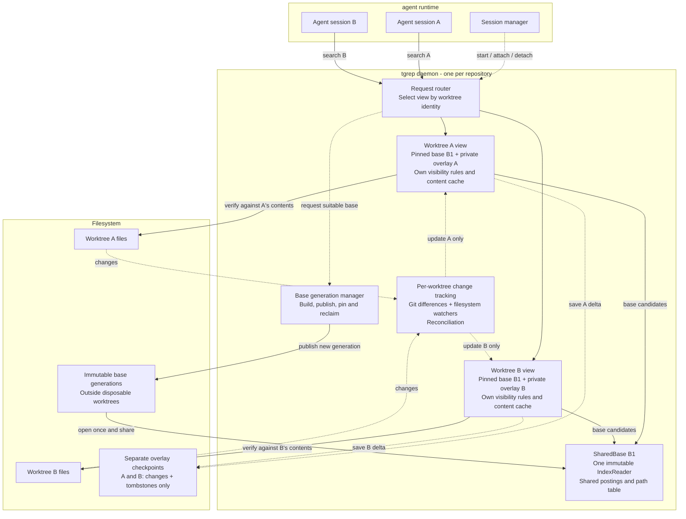
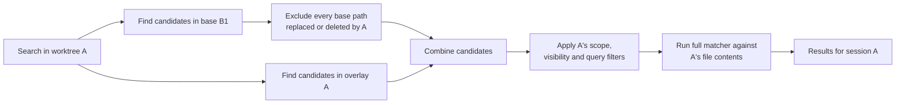
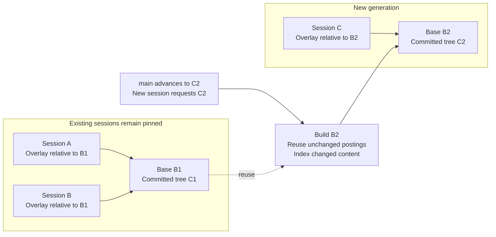

# Shared worktree index design

**Status:** shared readers, committed-tree generations, private reconciliation
and the opt-in repository daemon are implemented. **Managed v2 is recommended
for new shared-daemon integrations** and provides atomic advancement, owner
guards, reference-aware collection, allocations and storage-only maintenance.
It requires an explicit `--shared-policy` file; see the
[managed contract](#managed-client-contract) below.
Shared **v1 is deprecated as of tgrep 1.2.1 but remains supported**:
no-policy startup still selects its retain-all, fixed-pin contract and warns
once on stderr. This patch does not remove v1, change its protocol/storage, or
implicitly migrate or collect legacy data. No removal date or release is set.
The earlier sections describe the architecture and legacy v1 behavior.
Ordinary single-root CLI/server behavior remains the default and does not emit
this deprecation warning.

## Goal and ownership

An agent runtime may create many worktrees from the same repository. Rebuilding
a complete trigram index for every session duplicates indexing work, disk
storage, and memory. Instead, tgrep should share immutable base data and index
only the differences belonging to each worktree.

The boundary is: **tgrep owns search correctness; the agent runtime owns
session lifecycle.** The main checkout is another worktree with its own
overlay, not a mutable source of truth for every session.

| Responsibility | Owner |
| --- | --- |
| Shared readers, base generations, overlay precedence, persistence | tgrep |
| Git-difference discovery, watchers, reconciliation, safe scan fallback | tgrep |
| Worktree-specific filtering, filename membership, and content caches | tgrep |
| Starting/supervising the daemon and configuring resource budgets | Agent runtime |
| Attaching/releasing worktrees as sessions start/stop | Agent runtime |
| Supplying the intended starting revision and known-change hints | Agent runtime, validated by tgrep |

Runtime notifications are an optimization, not the source of truth. External
editors, Git commands, and build tools can change files independently.

## Overall architecture

Run one repository-scoped daemon, identified by the canonical Git common
directory, rather than by a remote URL or branch name. Linked worktrees share
this identity; unrelated clones do not accidentally share mutable state.



The daemon shares the actual `Arc<IndexReader>`, including its loaded path
table, not just the names of the memory-mapped files. Worktrees retain
independent roots, overlays, visibility/membership state, watcher queues,
and synchronization so a checkout in one worktree need not block another's
searches.

## Base snapshots and worktree overlays

A base describes an exact committed tree under a compatible indexing profile.
Its implemented key includes repository identity, Git tree OID, indexing profile,
and index-format version; retain the commit OID for diagnostics. The profile
must account for content decoding, checkout transformations, and corpus
coverage. Dirty and untracked files from the main checkout belong in its
overlay, never in the shared base.

Every worktree pins an exact base generation. Its overlay contains the
differences between that base and the worktree's current searchable contents,
not merely differences from its current `HEAD`.

| Difference | Overlay representation |
| --- | --- |
| Added or modified file | Postings for the complete current file |
| Deleted or newly ineligible base file | Tombstone hiding its base entry |
| Renamed file | Old-path tombstone and new-path entry |
| Eligible untracked file | Worktree-only entry |
| File restored exactly to the base | Remove the override and expose the base |

Use Git diffs to discover paths, not to index patch hunks. Whole-file indexing
preserves matching across edit boundaries, context lines, and line numbers.
Discovery must include committed branch divergence, staged changes, unstaged
changes, and eligible untracked files. A commit inside a session does not make
its differences from the pinned base disappear.

## Search flow



This illustrates the existing `HybridIndex` precedence model: overlay entries
shadow base paths even when their new content does not match the query.
Candidate IDs and path resolution must use the same pinned reader snapshot,
with overlay mutations synchronized for that operation.

The base supplies candidates, not another checkout's contents. Final matching
reads the requesting worktree or its correctly versioned cache. Cache entries
must not be keyed only by relative path across worktrees. Sharing cached bytes
by content identity is a later optimization requiring verified identity.

For example, editing `auth.rs` in A hides that path's base postings only in A.
Deleting `old.rs` in A hides it with a tombstone. B still sees its own versions.
The same membership/visibility rules must apply to content searches and
`--files`, including filename-only paths without searchable postings.

## Registration, readiness, and freshness

The versioned daemon API implements these operations; the concrete wire contract
is below:

| Operation | Purpose |
| --- | --- |
| `attach(root, revision, profile, lease)` | Select/pin a base, capture changes and return a view identity, lease and readiness |
| `search(root, view, query)` / `files(root, view, query)` | Route requests to the private ready view |
| `refresh(root, view, lease, changed, full)` | Invalidate immediately; return the processed epoch after reconciliation |
| `detach(root, view, lease)` | Release one lease; retire the view only after the final lease |

Normal CLI invocations should discover the same view automatically. Releasing
one session must not stop a daemon or worktree view still used by other clients.
Canonicalize and validate roots and request paths; a worktree identity is not
permission to read arbitrary paths. Protocol capability negotiation must
distinguish this service from the existing single-root server.

On attach, start capturing changes before establishing the initial delta.
Reconcile Git/filesystem state, replay queued events, and publish a consistent
base-plus-overlay view. If coverage is incomplete or change discovery fails,
scan rather than presenting a partial index as complete. A known changed path
can be verified by direct scanning while its replacement postings are built.

Keep periodic reconciliation and watcher-overflow recovery. Merely draining a
watcher queue does not prove that no filesystem notifications were missed.
An acknowledged refresh can establish that specified edits have been processed;
it is not a filesystem-wide snapshot guarantee. `--no-index` remains the escape
hatch for reading current disk contents under normal traversal rules.

Sharing removes repeated full-content indexing, not necessarily all
repository-sized startup work. Git status, untracked-file discovery, and
watcher registration may still inspect many paths. Measure these costs
separately before introducing filesystem-monitor or registration optimizations.

## When the base changes

**Never update a shared base in place.** Build and publish a new immutable
generation when a requested starting revision needs one. Deduplicate concurrent
build requests for the same compatible base.

| Event | Action |
| --- | --- |
| First session at a revision | Build a compatible base if none exists |
| Another session at the same tree/profile | Reuse the base and establish its overlay |
| Agent edits files or commits on its branch | Update only that worktree's overlay |
| New session starts from an updated `main` | Build or reuse a base for the new revision |
| `main` advances without a new session | No required work; background prewarming is optional |



Building B2 should reuse compatible unchanged postings and extract only changed
content. It can still require streaming/writing a new full index generation;
avoiding extraction does not eliminate publication I/O.

In default v1 mode, active sessions do not migrate automatically. A checkout or
rebase can be represented by recomputing that worktree's overlay against its pinned
base. An explicit base migration must instead recompute the delta against the
new base and atomically publish the new base-and-overlay pair. Swapping only
the reader would give the overlay the wrong meaning.

Retain old generations until no active worktree, in-flight query, or retained
restorable checkpoint needs them. A retention policy may evict idle checkpoints
and release their pins; restoration must then rebuild/reconcile, not silently
substitute another base. Defer removal of mapped generations on Windows.

The legacy `GenerationManager` implements **retain-all**, not online GC:
it never deletes or rewrites a published generation, even when its last
`Arc<Generation>` pin is dropped. This also protects escaped readers/views and
restorable checkpoints across process restarts. There is no deletion API or
automatic active-session migration in that manager. Reclaiming legacy storage
offline requires stopping all users and discarding dependent checkpoints. The
managed v2 adapter described below adds ownership-aware retention and resource
budgets in a separate namespace; absence of a live in-process pin alone is not
proof that a generation is deletable.

## Persistence and compatibility

Store bases outside disposable worktree directories. Persist each worktree's
delta separately, bound to its exact base and identity. Checkpointing a session
must not materialize another complete index or merge its changes into the base.

| Concern | Required behavior |
| --- | --- |
| Ignore rules and corpus coverage | Use worktree-specific membership. A shared tracked-path superset can avoid irreversible omissions; newly admitted files absent from the base still need discovery/indexing |
| Hidden files and `--files` | Maintain worktree visibility and filename-only membership, not just content postings |
| CRLF, encoding, LFS, smudge filters | Git blobs are not necessarily checkout bytes; reuse postings only with compatible content semantics, otherwise index affected files or scan |
| Sparse checkout, symlinks, submodules, case behavior | Respect materialized paths and existing traversal semantics, not just the committed tree |
| Incompatible query options or partial coverage | Fall back to the existing scan behavior rather than omit eligible files |
| Missing daemon/checkpoint/base | Use a validated reconciled view or scan; never silently answer from the base alone |
| Restart or interrupted publication | Validate the generation/checkpoint pairing and re-establish freshness before enabling indexed queries |

The current checkpoint implementation guarantees atomic replacement visibility,
including overwriting an existing checkpoint on Windows. It syncs file contents
before replacement but does not sync the parent directory afterwards; this is
**not a power-loss durability guarantee**. Stale or missing checkpoints must be
reconciled or rebuilt.

Existing CLI behavior, RPC protocol, index format, and single-root serving must
remain available while shared mode is introduced explicitly. Do not implement
sharing by pointing today's servers at the same `--index-path`: their
publication path still writes a complete index.

## Implemented generation API

`tgrep_core::generations::Repository::discover(root)` invokes Git without a shell
and identifies the canonical native common directory. `.git` files, linked
worktrees, subdirectories and bare repositories are supported. Independent
clones do not share identity, even with equal tree OIDs and remotes.
`Repository::git_dir()` retains the discovered worktree's metadata directory so
symbolic revisions such as `HEAD` resolve there, not at another worktree's HEAD.
Ambient `GIT_*` environment overrides and replace refs are ignored; Git failures,
missing objects and unsupported native/index paths are explicit errors.

`GenerationManager::new(repository)` uses
`<common-dir>/tgrep-bases-v1/<repository-identity>/`.
`with_storage(repository, storage)` accepts an existing trusted external
directory and uses a repository-identity subdirectory. It rejects storage in
registered worktrees, Git metadata or another index snapshot. Stores and their
ancestors must not be externally renamed or modified while in use.
Checks cover the effective canonical repository-identity directory as well as
the supplied parent, including an existing worktree or snapshot at that child.

| API | Contract |
| --- | --- |
| `Repository::resolve_commit_tree(revision)` | Resolve exact commit/tree IDs without building or publishing; symbolic revisions use the discovered worktree |
| `ensure(revision, profile, predecessor)` | Resolve an exact commit/tree, build or reuse the key; incompatible supplied predecessors error |
| `EnsureResult` | Pinned `Arc<Generation>`, requested commit, and per-request `BuildStats` |
| `open(key)` / `list()` | Open exact or list validated published generations; errors never become empty bases |
| `Generation::key()` / `commit_oid()` | Serializable exact repository/tree/profile/format/schema key; first publishing commit for diagnostics |
| `Generation::base()` | The shared `Arc<SharedBase>`; use existing worktree/overlay APIs without changing their validation |
| `entries()` / `entry(path)` | Sorted complete tracked membership, Git modes/OIDs/raw sizes and content classification |
| `TrackedEntry::matches_worktree_bytes(bytes)` | Decoded-content identity comparison only, not a freshness/visibility/eligibility claim |
| `retention()` | `RetentionPolicy::RetainAll`, including after all current pins drop |

The versioned profile is `RawGitBlobAutoV1` plus `TrackedRegularFilesV1` and a raw
blob-size cap (64 MiB by default; `None` disables it). It invokes the existing
automatic decoder, binary classifier and masked trigram extractor on raw blobs,
never checkout-filtered bytes. Ignore rules, hidden visibility and binary
extensions are deliberately not applied to this tracked-path superset.
Destination mode/size eligibility is always recomputed. Only regular-file
predecessor entries with compatible indexed content supply reusable postings.
Binary entries may reuse their classification, but cannot supply absent postings.
Empty and short text entries carry a content identity even with zero postings.
Oversized, binary, symlink and gitlink records remain distinguishable in tracked
membership; symlinks and gitlinks are not followed or content-indexed.

Clean Git status and equal blob IDs do not prove equivalence of worktree bytes.
The synchronization layer verifies decoded identities from checkout reads, or
overlays transformed/changed files. It also applies worktree-specific membership,
including ignored/extension-filtered files, sparse checkout and filesystem case
behavior. The profile's optional content eligibility selects whether the
extension filter applies ([content eligibility profiles](#content-eligibility-profiles)). Non-UTF-8 tracked names, unsafe relative paths, and paths unrepresentable
on the current platform are explicit unsupported errors, not lossy aliases.
Native repository paths are retained losslessly. Content/coverage enum versions
must advance if their semantics change, independently of the index format.

A supplied compatible predecessor provides postings by blob identity, including
renames/copies, without reading unchanged blob contents. Changed/new blobs are
read and extracted in byte-bounded batches by parallel `git cat-file --batch`
readers (bounded by available/namespace workers and the private reservation),
with the next batch prefetched while file IDs are assigned and pushed to the
existing spill sorter in the serial order, so output stays deterministic; private
pressure falls back to one blob at a time. The build then publishes a complete
streamed index. Memory includes at most two batches of extracted masks,
O(tracked paths) metadata and the bounded sorter arena, not all postings.
Without a predecessor the first build extracts the full committed corpus.
`BuildStats` counts actual blob reads/bytes, extraction calls, reused indexed
files, copied postings, and whether this request published or reused a generation.
`predecessor_posting_lists_read` counts decoded predecessor lists; when no indexed
paths reuse postings, generation creation does not traverse the predecessor.
Empty/short indexed files retain their paths and content identities without
triggering that traversal. Strict snapshot opening records per-file posting
presence during its existing validation pass, including for older generations;
there is no new metadata field, format boundary, or additional posting scan.
Publication I/O and metadata enumeration are not eliminated by extraction reuse.

One OS file lock per repository store serializes cooperating processes, including
different-tree builds; it is released on process exit/crash. A weak in-process
cache shares live `Arc<Generation>` pins and their shared reader/path table.
Cold validation/fingerprinting runs outside the process-wide cache mutex, so it
does not block unrelated repository cache hits; insertion rechecks for a winner.
Staging uses unique `.stage-*` directories on the same filesystem. The complete
index is strictly opened, its fingerprint and checksummed tracked metadata
validated, and files synced before atomic directory rename to the key's name.
Final directories are never overwritten, even if corrupt. Abandoned staging
directories are ignored, not advertised or automatically garbage-collected.
Atomic visibility is not a parent-directory power-loss durability guarantee.
These checks detect inconsistent/corrupt data; storage must still be trusted,
not treated as an authenticated format for adversarially rewritten files.

The synchronization layer retains the generation pin with each view and serializes
its key inside the delta checkpoint. The generation's `SharedBase` fingerprint still
binds the checkpoint to exact index bytes. Reopening that key is not readiness:
reconcile the worktree before enabling indexed queries.

## Implemented worktree synchronization API

`tgrep_core::worktrees::WorktreeView::new(root, pin, options)` validates that the
canonical root is an actual worktree root in the pinned repository. Independent
clones, bare repositories and subdirectory roots are rejected. The exact
`Arc<Generation>`, canonical root and worktree Git directory stay with the view;
no mutable base/flush handle is exposed and no base migration occurs.

| API | Contract |
| --- | --- |
| `WorktreeOptions` | Existing `MetaWalkOptions`, bounded `hint_capacity`, optional existing private `checkpoint_directory` |
| `invalidate_path(relative)` | Close query gate; queue a file/subtree hint, including old/new rename paths; invalid input errors and forces full repair |
| `invalidate_all()` | Close gate and require full verification for startup, watcher overflow or explicit missed-event repair |
| `invalidate_tree()` | Close gate and request a membership/metadata walk, retaining explicit read hints |
| `refresh()` | Rewalk membership/visibility; verify hints/new/stat-changed files or, without hints or tree work, all admitted contents |
| `reconcile_full()` | Always read/verify content, irrespective of size/mtime/Git-status equality |
| `status()` | Ready flag, invalidation epoch, published epoch, pending-path count and tree/full-required flags |
| `with_snapshot(closure)` | Guarded query-only view with root/epoch/visibility, resolved paths and read-only candidate opens; verifies pinned-root identity before/after the callback |
| `save_checkpoint()` | Ready-only, delta-only atomic `overlay.json`, including exact generation key/root/base binding |
| `restore(root, pin, options)` | Explicit errors for missing/invalid/mismatched checkpoints; successful restore remains not ready |
| `ReconcileStats` | Actual content reads/bytes/decodes/extractions, base/overlay reuse, copied base files/postings, reads avoided and `hint_lookups` ordered-set probes |

The agent runtime subscribes **after construction and before initial refresh**,
then forwards native/polling/no-watch inputs through these same invalidations.
Each refresh makes one bounded attempt, serialized per view. Files are prepared
outside the readiness lock; invalidations can continue to arrive. Overlay,
visibility and filename membership publish together only if the captured epoch
still matches. Otherwise `ChangedDuringReconcile` leaves the view not ready with
the original full/tree/path work pending. Retrying retains read hints; sustained churn must
scan or wait, never spin indefinitely. Incomplete metadata walks (including
ignore-rule errors), unreadable tracked exemptions, failed reads and detected
read instability also keep the gate closed. No base-only success is possible.
Native directory/file names are validated before converting metadata-walk paths
or recording visibility. Non-Unicode names and literal Unix backslashes produce
discovery errors instead of aliasing valid or ignored paths; ordinary native-path
full scans remain the fallback.
Reconciliation holds a stable root directory handle. The extracted
`tgrep_core::rooted::RootedDir` helper (`open`, relative `open_file`, `verify_root`)
is also retained once per ordinary server and reused across indexing, watcher
and verification passes, rather than reconstructed for each file open. Unix descends with component-relative
`openat`, `O_NOFOLLOW` and `O_NONBLOCK`, then verifies the final handle is regular.
Windows holds ancestor handles without delete sharing, rejects reparse
points and validates the final handle's containment and actual parent before
reading. File version and identity are rechecked through rooted handles; a root identity change also
prevents publication. Errors leave readiness closed, including directory/link
swaps and regular-file/FIFO swaps. Windows keeps the root guard until view drop;
agent runtimes must release registrations before removing or renaming worktrees.
Ordinary serving retains its root guard for the server lifetime too: stop the
ordinary server before removing or renaming its served root on Windows.
Each reconciliation advances the epoch, including no-hint full repairs, so
successful publication acknowledges earlier invalidation tokens with an equal
or later epoch.

`WorktreeSnapshot::candidates(plan, prefix, include_hidden)` resolves both base
and live IDs before releasing the overlay guard. `files(prefix, include_hidden)`
comes from complete walker filename membership, not posting lists.
`open_file(relative)` returns a read-only regular-file handle from the view's
retained reader, never from a new registration of the root pathname.
`with_snapshot` checks pinned-root identity before and after every callback,
including empty/file-only queries; failure invalidates readiness and queues full
reconciliation. Candidate-open failures are latched and returned as an outer
I/O error, with readiness invalidated before releasing the guard even if the
callback swallowed the error or subsequently opened another file successfully.
A callback may return the owned handle for bounded matching
outside the guard; reenter `with_snapshot` and verify the original epoch before
publishing buffered results. File contents are not frozen by these handles.
Later handle-read errors remain caller-owned: report them and call
`invalidate_all()` after leaving the guard, without publishing partial results.
Hidden files
are included in canonical coverage and filtered at query time, including Windows
attributes and explicit hidden-directory scopes. Existing walker rules determine
ignore/extension, materialized symlink/submodule and regular-file behavior.
Missing, sparse and ineligible base paths are tombstoned; staged, unstaged,
committed-divergent and eligible untracked files use whole-file overlays. Restoring
the pinned content removes the override; committing divergent content does not.

Full passes walk without a metadata-only size cutoff, then bound actual reads to
the configured limit plus one byte and classify the bytes read. Eligible content
is auto-decoded and hashed before reuse, so CRLF, smudge, encoding, assume-unchanged
and skip-worktree cases cannot rely on clean status or index stat data. Verified
content-identical copies/renames can populate new overlay paths by copying base
masks in one streaming posting pass. Matching existing overlays keep their masks.

This saves trigram extraction, **not all repository-sized startup work**. Every
refresh walks metadata and membership. Full passes read/verify all admitted
content; hinted passes can retain previous evidence for unaffected paths under
the explicit event-driven freshness contract. Case-alias hints conservatively
reverify. Non-ASCII hints cover the longest ASCII directory ancestor, and
capacity overflow coarsens hints to ancestors. Only unrepresentable coverage
requires full verification.
Accepted hints are rebuilt from normal path components, so trailing/repeated
separators and interior `.` spellings cannot lose subtree invalidations. Absolute,
parent-component and leading `.` component hints still error and require full repair.
Hint matching probes a `BTreeSet` for the normalized full path and ancestor
prefixes, rather than scanning every hint for every file. `hint_lookups` counts
these probes (at most twice the path depth per file, each logarithmic in queue size);
the regression uses 2,001 pending hints but only five probes for two files.
Hinted passes still open eligible regular-file handles for safe metadata
verification even when content reads are avoided.
Same-size/restored-mtime edits without notifications are repaired by forced
full checks, not promised by hints. Successful refresh acknowledges processed
inputs, not an atomic filesystem snapshot. Final matching uses
`WorktreeSnapshot::open_file` or a private versioned cache, not an ordinary read
of `snapshot.root().join(path)` that could follow a raced link outside the
worktree. Contents can still change through later writes to the opened file.

Raw LF blobs and clean CRLF/smudge checkouts may differ for **every file**.
Normalizing line endings would invalidate positional/next-byte masks. Fixtures
assert three identical tracked files are read/decoded with zero extractions,
versus four clean transformed tracked files requiring four private extractions.
The linked worktree's plain `.git` pointer file adds one private extraction
in either case; later unchanged passes reuse all private overlays.
No transformed-content cross-view cache is
implemented. Preparation retains O(paths) metadata plus changed-file masks
until publication, in addition to the existing private overlay. A large
transformed checkout can therefore require substantial private memory.

Checkpoints use the foundation's single directory-bound atomic publication;
there are no unprotected auxiliary manifest writes. A configured private
checkpoint path must be an existing directory; construction, restoration and
saving reject regular-file paths instead of accepting an unusable view.
The checkpoint directory is excluded in its entirety (including staging files),
along with `.tgrep`, Git metadata directories, generation storage and caller-supplied
`walk.exclude_paths`. It cannot be an index snapshot, Git metadata or a worktree
ancestor. Storage must remain trusted and not externally renamed while in use.
The plain `.git` pointer in a linked worktree follows ordinary walker membership:
its filename and content are available with hidden inclusion, subject to ignore
and size rules. The named Git metadata directories remain excluded; the file's
contents are not followed as a filesystem link.
Restoration validates the exact generation key, base bytes and canonical root but
does not restore readiness or trusted read evidence; first reconciliation may
re-extract restored private postings. Missing/stale/invalid state is an explicit
recoverable error, not an empty overlay. Legacy bases remain immutable and
retain-all.

This fixed-generation `WorktreeView` layer does **not** own native watchers,
automatic shared CLI serving, daemon routing/wire schemas or content caches.
Existing CLI/server behavior is unchanged unless a worktree is explicitly
attached to the daemon described below.

## Daemon wire contract v1

**Deprecated as of tgrep 1.2.1, still supported for existing clients.**
New integrations should use the [managed v2 client contract](#managed-client-contract)
with an explicit [policy](#managed-policy). The no-policy invocation below
continues to select v1; its one-time startup warning goes only to stderr, never
stdout or the RPC stream.

Run `tgrep serve --shared ROOT --shared-storage EXISTING_EXTERNAL_DIRECTORY`.
The runtime supervises this foreground process. `shared attach ROOT --revision
REV --lease TOKEN`, `shared refresh ROOT --lease TOKEN [--changed REL ... | --full]`, and
`shared detach ROOT --lease TOKEN` are CLI wrappers emitting one JSON result.
The new literal subcommand name must be escaped as a pattern: `tgrep -- shared .`.

The common Git directory holds `tgrep-daemon-v1.json` (protocol, random-like unique
instance ID, repository identity, PID, loopback port, canonical storage path).
An OS lock in the same directory excludes a second daemon even with a different
storage choice. The listener/worker queues exist before registration publication.
Every attached worktree has a separate `tgrep-view-v1.json` in its **actual
worktree git_dir**, binding the daemon instance, canonical root, view ID and exact
generation. No `serve.json` schema is overloaded. Attach publishes this marker;
last detach removes it only if instance/view still match. Discovery stops at the
nearest Git boundary and validates capabilities, root/base/profile and readiness
before emitting any rows. Merely having a daemon is not attachment.
Client discovery carries one validated root/repository through daemon discovery
and lookup. A CLI invocation discovers once per worktree and revalidates that
client with `lookup` for each further path argument. Legacy v1 discovery runs
three Git subprocesses; managed v2 discovery reads the gitfile, `commondir` and
markers instead and runs none. Daemon query
workers launch no Git subprocesses: they reuse the attached repository, rechecking
canonical root, nested boundaries, gitfile target and common-directory identity.
Real Git trace2 process-start events assert these counts in integration tests.

RPC is one newline-delimited JSON request/response per TCP connection, loopback
only. All requests have this envelope (including `hello`):

```json
{"jsonrpc":"2.0","protocol":1,"instance":"FROM_DAEMON_MARKER","repository":"FROM_DAEMON_MARKER","id":1,"method":"hello","params":{}}
```

Successful results repeat `protocol`, `instance` and `repository`. Errors have
`error.code` and `error.message`, never success-shaped empty results. V1 rejects
unknown envelope/parameter fields, malformed options and incompatible identities.
Clients require the matching request ID on successful responses. A valid error
object (integer code, string message, no result) may instead have an explicit
null ID when rejected before request parsing, preserving connection-queue
saturation diagnostics. Missing/mismatched IDs and malformed errors are rejected.
Search RPCs must omit `passthru` or set it to `false`; `true` is rejected with a
scan-required error because indexed candidates omit nonmatching files. The CLI
keeps `--passthru` on its existing filesystem-scan path when it emits all lines.
Canonical worktree roots must be UTF-8 for JSON transport. CLI and server reject
unsupported roots, including Unicode aliases to them, before serialization or
generation publication; the core API's native-path support is unchanged.
Gitfile and `commondir` targets retain native path bytes on Unix, even when
metadata lives outside a UTF-8 worktree. Discovery and identity revalidation
share the same decoder without spawning Git on the daemon's hot query path.
The existing `ignore` dependency is vendored at its locked version with the
same native-path correction in Git ignore-source discovery; ignore precedence,
nested repository boundaries and malformed-ignore failures are preserved.
See [dependency provenance and distribution](vendor/ignore/PATCHES.md).
Instance IDs prevent stale metadata/port reuse; they are not authentication
against hostile local processes. Storage, repository metadata and the loopback
user environment are trusted.

| Method | `params` | Result-specific fields |
| --- | --- | --- |
| `hello` | `{}` | `capabilities`, `profile`, `retention`, `limits`, `paged_results`, `filtered_files` |
| `attach` | `root`, `revision`, `profile`, `lease` | `view`, `lease`, `root`, `generation`, `requested_commit`, `ready`, `attach_build` |
| `lookup` | `root` | Current view descriptor and status; does not create a lease |
| `status` | `root`, `view`, `query: {}` | Readiness, pending/full flags, epoch, last error/success, watcher mode, sharing/extraction counters |
| `refresh` | `root`, `view`, `lease`, `changed: []`, `full: false` | Descriptor plus `processed_epoch`; no hints means full verification |
| `detach` | `root`, `view`, `lease` | `remaining_leases`, `detached`, `view`, nullable `registration_warning` |
| `files` | `root`, `view`, `query: {scope, hidden, max_depth}`; with `filtered_files`, optional `glob`, `iglob`, `glob_case_insensitive` and `type_ops` (or the per-kind type arrays) | Root-relative `files`, `epoch`, `ready`, `generation`, `backend: "shared-v1"` |
| `search` | `root`, `view`, `query` | Root-relative match/context rows, `file_stats`, `index_stats`, `epoch`, same view/base/backend fields |

The `recoverable-attach` capability requires a caller-owned `lease` on every
attach RPC: 1-128 ASCII letters, digits, hyphens or underscores. Persist a unique
token before sending. Repeating a live token with the same canonical root,
literal revision and profile replays the original attachment and `attach_build`
statistics, without allocating another lease or re-resolving symbolic revisions.
It works at the lease limit and after response loss. A token already used by
another root/revision is an error. Distinct callers use distinct tokens.
`lookup` followed by `detach` also releases a known token without its original
response; the CLI does that lookup automatically. Tokens are scoped to the
daemon instance, are not authentication credentials, and are forgotten on detach
or restart. After restart, explicitly attach again with fresh tokens.
Final detach always releases the view/lease even if registration cleanup fails;
it reports the failure in `registration_warning` and daemon stderr. Missing
markers are harmless. Corrupt or foreign markers are not removed without
matching instance/view identity, so their continued presence selects safe fallback.
CLI `--lease` is optional for interactive convenience: if omitted, a generated
token is printed on stderr before transmission and must be captured and supplied
on retry. Runtime integrations should always supply their own token.

The `profile` is required on attach:

```json
{"content":"raw-git-blob-auto-v1","coverage":"tracked-regular-files-v1","max_blob_bytes":67108864}
```

#### Content eligibility profiles

The profile may also carry `"eligibility":"content-only"`. The default,
`extension-and-content`, is omitted from the wire form, so default profiles,
generation keys, storage names and `hello.profile` are unchanged. Daemons that
support the optional field advertise the `content-eligibility-profile`
capability; older daemons reject the unknown field on attach.

| Stage | `extension-and-content` (default) | `content-only` |
|-------|-----------------------------------|----------------|
| Committed base | Raw tracked blobs, content-classified; no extension rule | Same corpus, but a distinct generation key and storage name |
| Overlay/verification | Binary-extension paths have no content and hide the base entry | All listed files are decoded and classified by content; clean text reuses the base, NUL content is excluded |
| Incremental and full refresh | Same path rules | Same path rules; the profile is never re-chosen |
| `--files` | Unaffected | Identical filename membership |

Ignore, hidden, size, symlink and NUL/binary classification are the same in
both profiles. The profile is part of the pin: a join, accept-current attach
or migration with a different profile fails, so every client of one worktree
root must request the same eligibility. Checkpoints restore only into the same
profile. Unmanaged v1 leases accept only the default. To change a root's
profile, release every lease; a fresh `views.attach` with an explicit
`revision` and no `accept_current` then replaces the inactive view (retryable
`previous-root-readers-active` while old readers drain). No close RPC is needed.

Queries state their eligibility. The CLI sends `content_eligibility:
"content-only"` in the search query when run with `--content-eligibility
content`, and omits the field otherwise. Before using a discovered view, the
client compares the requested eligibility with the view's generation profile.
The server makes the same check for content queries (not `files`). A mismatch
in either direction is refused with the shared-fallback warning, and the
client scans the filesystem using the requested rule. A legacy view is never
served under a wider-coverage request, and a content-only view is never
served to a default request. Older clients see a non-default profile and fall
back. Content-eligibility queries never use an ordinary server or local index.

A runtime that wants ripgrep-compatible extension handling should check
`content-eligibility-profile`, attach with:

```json
{"content":"raw-git-blob-auto-v1","coverage":"tracked-regular-files-v1","max_blob_bytes":67108864,"eligibility":"content-only"}
```

and query with `tgrep --content-eligibility content ...`. With `--stats`, a
managed answer reports `(via shared daemon v2)`. A content-only base is
built and stored separately from a default base for the same tree.

`query` uses the existing search RPC fields built by `server_search_request`:
pattern/extra_patterns, matcher flags, types/type_add/type_clear, globs,
context/output-detail fields, `count`/`count_matches`, hidden, scope and max_depth.
`count: true` returns one `{"type":"count","file":"...","lines":N}` row per
matching text file. `count_matches: true` returns one path row plus the original
per-file totals. Binary markers retain their counts and client-side visibility
filtering; `stats` still returns the original match totals without restoring
content rows. Legacy non-counting requests keep their existing response shape.
JSON clients additionally send `search_stats: true`. The response's
`search_stats` array contains `{"file":"...","bytes_searched":N,"binary_offset":null}`
for every candidate searched, including those with no matching rows; a binary
candidate carries its numeric detection offset. These receipts are collected
at matching time, charged to the existing response budget, and filtered by the
client's normal scope/binary visibility rules. They require no extra reads and
do not claim full-scan work. Missing or malformed receipts are rejected before
output; older shared servers reject the new query field, causing the usual
diagnosed scan fallback. Queries without this field keep their prior shape.
Only default automatic
decoding and the 64 MiB profile are compatible. `scope` is empty or an existing
relative directory, never a regular file; it cannot escape the root or cross a nested repository. Content reads
use no-follow root-contained handles, never another worktree's content cache.
Candidate collection captures an epoch; a concurrent invalidation rejects the
response before output. Read failures invalidate the view and return errors.

Views are shared only for the same root and exact tree/profile. Independent lease
tokens release independently, have no automatic expiry, and are invalid after
restart. Reattachment resolves and compares the requested tree with the existing
pin before any generation build/publication; a different commit with the same
tree is compatible when using a new lease. New generations may reuse a compatible currently pinned predecessor;
existing views never migrate. All generations/checkpoints are retained.
Generation and overlay directories are separate under external storage. A saved
delta is keyed by canonical root and exact generation and is full-revalidated on
reattach. Unavailable/corrupt generations or checkpoints cannot reveal the base.

Normal CLI search/files/status automatically use an existing attachment.
`--shared` additionally forces shared-only discovery. Explicit `--index-path`
preserves ordinary index intent unless combined with `--shared`. Stale/missing
forced registrations, incompatible options, saturation and not-ready states
produce meaningful scan diagnostics, bypassing all ordinary index shortcuts.
Marker entry presence includes dangling symlinks, so corrupt metadata cannot
silently select a stale ordinary index.
`status` reports an error rather than misleading legacy status. `--no-index`
always scans. Positive indexed globs filter the admitted corpus; scans can
reinclude ignored files, as with ordinary indexes.

Limits are aggregate and visible in `hello`: 32 views, 256 leases, 8192 native
subscriptions and 16384 hint slots by default. `--shared-max-views`,
`--shared-max-leases`, `--watch-budget`, `--watcher-queue-cap` select them.
Watch/hint budgets are fixed per-view shares of the configured maximum; there
is no borrowing. Bounded nonrecursive registration reuses the ordinary watcher
registry on each platform; too many directories or registration errors select
polling rather than partially claiming native coverage. There is one serialized
index/reconcile worker and two separate query workers, so repairing A does not
take a repository-global search lock or prevent ready B from searching. Query
workers search on a dedicated thread pool with one thread per logical core
(or `RAYON_NUM_THREADS`), so reconciliation batches never hold the threads a
query needs. Work
queue capacity is max_views; query queue is 16, incoming connection queue 32.
Two routers enforce 1 MiB requests and timeouts. Responses over 64 MiB fail
explicitly without truncation. An encoded-byte budget checks borrowed rows before
allocating their JSON objects, counts filename/statistic/escaped-string overhead
across files, and bounds final serialization. Existing per-file matching state
and candidate/path tables remain proportional to the admitted input corpus;
the response cap is not a total-process memory cap. There is no content cache.
Mapped generations, path tables and private
postings still scale with repository/overlay size, not with a fixed memory cap.
Native directory registration and event filtering exclude the root's `.tgrep`
storage directory, not eligible hidden directories such as `src/.tgrep`.

Callbacks immediately invalidate the appropriate view; hints are bounded and
overflow/unknown events request full repair. Registration precedes initial
reconciliation. A failed or concurrently invalidated pass stays not ready and
retries; no base-only window exists. Consecutive failures use completion-based
exponential retry delays of 1, 2, 4, 8, 16 then 30 seconds; success or explicit
refresh resets the delay. Explicit refresh does not wait for the retry deadline.
Status exposes `reconcile_attempts`, `consecutive_failures`, `retry_delay_ms` and
the retained `last_error`. Daemon readiness stays closed until both the core
refresh and checkpoint publication finish, including failed checkpoint retries.
Candidate files are opened through the view's retained snapshot reader. Every
query ends with a root-verified snapshot, including empty and filename-only
responses (strict views also reject a changed epoch there); replacing the
directory cannot pair old candidates with a new root.
Local-index and shared searches amortize ancestor opens across bounded groups
of up to 64 consecutive siblings. Each group retains one parent chain, not an
unbounded directory cache or a batch of file contents. Shared searches size
groups so that a small search still spreads over the query threads: the
candidate count divided by the smaller of six and the thread count, at least 8
files per group. Shared candidate batches retain the generation and root
protection. For a group of two or more siblings, one snapshot verifies the root
and pins the ancestors, the siblings open through that pin without
per-candidate snapshots, and `finish` verifies the root and ancestor identities
before the group's results are used; the query's final snapshot verifies the
root again. A single candidate still opens through its own snapshot. Every read
first revalidates the query. Open/read or final ancestor-verification failures
close the view for repair (eventual managed v2 views instead skip that candidate
and queue it as a path hint; see **Eventual serving**). An eventual group whose
`finish` fails is skipped and requeued once a snapshot confirms the root; a
replaced root closes the view. Deadline and snapshot-validation failures,
including those found while classifying a failed open, do not masquerade as
filesystem failures. This does not change admission, matching, response limits
or fallback semantics.
In the legacy v1 daemon, both auto and poll modes perform full
verification every `--poll-interval` seconds after completion (default 120), also
repairing missed bytes, ignores and external Git/global configuration changes.
Native notifications allow earlier incremental repair. `--no-watch` disables
both periodic and native refresh, not initial reconciliation or explicit runtime
refresh. Neither ready nor a processed epoch promises the newest possible bytes.

Integration tests measure three unchanged tracked files as 3 reads/decodes,
0 private extractions, and the same `Arc<SharedBase>` in both views. A linked
worktree's ordinary `.git` pointer file adds 1 read/decode and 1 private extraction
on initial reconciliation (4 reads and 1 extraction total); it remains visible
with `--hidden`, while real Git metadata directories stay excluded.
Four CRLF-transformed paths require 4 private extractions plus the linked
gitfile's 1 (5 total), with 0 new extractions on no-op verification.
Sharing never promises to eliminate startup reads or checkout transformations.

### Stateful parity and runtime lifecycle exercisers

The existing `shared_daemon` integration fixture also runs two bounded seeded
sequences (`stateful::`) and a process supervisor (`runtime::`). These are
test-only helpers, not an integration SDK or an automatic lease collector:

```sh
cargo test -p tgrep-cli --test shared_daemon -- stateful:: runtime::
cargo test -p tgrep-cli --test ripgrep_compat indexed_json_preserves_utf8_match_and_context_offsets
```

The parity sequences compose edits, additions, deletes, renames, staged and
unstaged versions, committed divergence, ignore changes, restoration to the
pin, reset/checkout/rebase, sparse materialization, CRLF checkout bytes and
daemon restart across three real worktrees. A small independent file/line model
checks isolation and membership, including hidden gitfiles, empty files and
filename-only binary entries. CLI line/count/match/file/JSON output is compared
with `--no-index`; scans exclude the main worktree's actual `.git` directory
because shared indexes intentionally exclude Git internals. Linked gitfiles
remain included. Unicode `-F -i` folds are checked through both base and overlay
paths, ignores and restarts. JSON comparisons retain offsets, lines, submatches
and match totals; only timing and backend work counters are normalized.
The accompanying regression checks multibyte UTF-8 before later match/context
rows through scans, local indexes and the ordinary server.

Every comparison requires the shared backend (RPC identity plus CLI stats/query
counters); a scan fallback cannot count as passing parity. Writes stop before
acknowledged hinted/full refresh barriers. Native-watch sequences additionally
require an event-driven publication before explicit refresh, with bounded retries
only for documented not-ready/concurrent-invalidation responses. This tests
processed-input contracts, not a promise that readiness proves latest disk bytes.

Defaults use seed `1742026`, one round per watch mode and small fixtures in normal
CI. Set `TGREP_SHARED_SEED` to a decimal u64 and `TGREP_SHARED_ROUNDS` to `1..16`
for replay/stress; invalid values fail rather than silently changing coverage.
Failures print the seed, round count and ordered operation log. Roles and edit
payloads vary by seed while prerequisite-dependent transitions remain ordered.
Each sequence has a 300-second-per-round overall deadline.

The supervisor persists caller-owned tokens outside worktrees before spawning
actual client processes. It combines simultaneous callers, repeated/lost-response
attach at the lease limit, explicit crash/timeout cancellation, journal-based
abandoned-lease recovery, daemon restart with fresh tokens, budget release and
detach-before-move/remove while a sibling keeps querying. Abandoned v1 leases remain
live until the runtime explicitly releases them; they have no expiry or GC.
File-backed child output avoids pipe deadlocks, RPC/start/stop waits are bounded,
and owned child guards kill/reap only their own PIDs on failure. The ignored
`runtime::runtime_client_process` test is a subprocess entry point invoked by the
supervisor, not an additional standalone test to run with `--ignored`.
Run watcher qualification on native filesystems (including native-ext4 WSL
checkouts rather than DrvFS); no platform is silently skipped.

## Implementation status and rollout

The implemented increments are additive; shared serving requires explicit opt-in:

| Surface | Current status |
| --- | --- |
| [`SharedBase`](tgrep-core/src/shared.rs) | Opens a validated reader once; creates independent worktree-rooted views sharing its `Arc` |
| [`HybridIndex`](tgrep-core/src/hybrid.rs) / [`LiveIndex`](tgrep-core/src/live.rs) | Reuses existing candidate merging, replacements, and tombstones |
| Overlay checkpoints | Atomic delta-only save/restore; validate format, root, paths, and exact base fingerprint |
| Base identity | Index fingerprint plus repository/tree/profile/format/schema generation key |
| Base immutability | Generation manager stages/validates/publishes once; external callers must not mutate mapped files |
| [`Regression coverage`](tgrep-core/tests/shared_worktrees.rs) | Sharing/isolation, masks, tombstones, restoration, compatibility, repeated saves, and Windows failure recovery |
| [`Generation management`](tgrep-core/src/generations/mod.rs) | Canonical common-dir identity, raw committed-tree builds, incremental posting reuse, cross-process deduplication, pins and retain-all |
| [`Generation coverage`](tgrep-core/tests/generations.rs) | Temporary repositories/worktrees, thread/process races, content transformations, immutable old readers, errors and interrupted publication |
| [`Worktree synchronization`](tgrep-core/src/worktrees.rs) | Pinned private views, actual-content verification, atomic readiness/membership, bounded invalidations, full repair and bound checkpoints |
| [`Synchronization coverage`](tgrep-core/src/worktrees/tests.rs) | Real divergent worktrees, scan/candidate parity, CRLF/smudge/decoding, sparse/assume-unchanged, filtering, epochs, errors and extraction counts |
| Legacy v1 CLI/daemon routing and native watchers (deprecated, supported) | Versioned leases, discovery, bounded workers/watchers/hints, full repair, delta checkpoints, strict scan fallback |
| [Managed lifecycle](tgrep-core/src/managed/mod.rs) | Isolated guarded storage, transactional catalog, owner lifetimes, versioned migration, allocation admission, bounded collection and offline maintenance |
| [Managed CLI/RPC](tgrep-cli/src/serve/shared/managed.rs) | Negotiation, asynchronous operation receipts, owner holder, recovery, adaptive scheduling, live diagnostics and atomic idle shutdown |

Shared-base validation rejects mismatched empty lookup/posting sections and
metadata counts inconsistent with the opened sections, while allowing empty
indexes and short files. Shared snapshots require aligned, contiguous posting
ranges covering the entire postings section, valid trigrams, strictly
increasing valid file IDs in each posting list, and nonzero location masks.
Checkpoint destinations reject trailing separators and
current-directory suffixes, and exclude the base and its
descendants by directory identity, even if the base has been renamed. Unix
staging, replacement, and cleanup are relative to an open parent-directory
handle; Windows holds non-delete-sharing handles on the canonical parent and
all its ancestors until publication completes. A renamed/replaced pathname
cannot redirect publication into the base. Root identities preserve the existing
JSON string encoding for Unicode paths and use tagged platform-native units for
non-Unicode Unix/Windows paths; older readers reject the latter representation.

Both modes keep one shared base plus one private overlay per worktree, using
the same builder, matcher, rooted reads, reconciliation and query pipeline.
Managed lifecycle does not introduce a second search engine or a shared mutable
branch overlay.

## Managed storage and lifetime boundary

`serve --shared ROOT --shared-storage CACHE_PARENT --shared-policy POLICY_FILE`
opts into protocol/storage schema 2. `CACHE_PARENT` must already exist and be
trusted. The policy selects one immutable namespace storage kind:

| Kind | Reader/storage contract |
| --- | --- |
| `managed` | Guarded generation/checkpoint format; published objects can be collected under bounded policy |
| `compatibility-retain-all` | Adapter over legacy generation storage; v1 participants remain fixed-pin and legacy objects are never collected |
| No policy file | Deprecated but supported v1 daemon, with unchanged layout, flags, leases and retain-all behavior |

The managed namespace is `CACHE_PARENT/tgrep-managed-v2/<repository-id>`.
Repository identity derives from the canonical native Git common-directory
identity, not a remote URL, branch name or disposable worktree. Two repositories
may use the same cache parent without sharing catalogs, accounting or authority.

```text
namespace.json        schema, namespace/repository and filesystem identities
owner.lock            exclusive namespace owner: daemon OR maintenance
activity.lock         admission/idle boundary, including independent readers
catalog.sqlite        transactional object/reference/operation/current-view catalog
guards/               per-incarnation and worktree-root lifetime guards
owners/               issued owner guard files and sealed instance challenges
objects/<physical-id> managed generation or checkpoint incarnation
```

Managed generation files use `paths.tgm`, `lookup.tgm`, `postings.tgm`,
`meta.tgm` and `generation.tgm`, incompatible magic and file-table format
`0x4d320001`. Old and unguarded readers reject them even under renamed legacy
filenames. No legacy-readable intermediate is published inside the managed
namespace. Ordinary index commands also refuse a store directory itself and
paths beneath its 64-hex repository namespaces, compared lexically and
case-insensitively; an unrelated directory that merely shares the store name
stays usable. Existing v1 stores are not converted or retroactively made collectible.

Managed namespaces also require a supported content-authentication format.
Missing or incompatible producer proof is not upgraded by hashing whatever
bytes happen to be present. This boundary is separate from protocol negotiation:
ordinary indexes and default v1 retain-all namespaces keep their existing format.

Each publication has a fresh physical incarnation independent of its logical
repository/tree/profile key. A delayed deletion of an old incarnation cannot
delete a replacement for the same logical key. Catalog, namespace and instance
IDs are opaque 32-character lowercase hexadecimal identifiers, not paths or
authorization credentials.

`managed::open_generation` and the managed generation/checkpoint adapters acquire
OS-backed protection before opening data. Protection follows escaped
`Arc<Generation>`, `SharedBase`, `IndexReader`, derived worktree views, snapshots
and rooted candidate handles, including independent processes. It also covers
build predecessors, checkpoint restore and both sides of migration. Local
`Arc` counts alone are not reclamation evidence. Per-object guards allow an
unrelated obsolete object to be collected while ready views continue serving;
the namespace activity guard is used for idle shutdown, not to block all GC.
Guard acquisition is authorized against the current catalog state while
retirement is excluded. A stale root, owner claim or generation open cannot
probe a retired guard and disrupt its physical reclamation. Releasing the last
root handle withdraws that incarnation; bounded maintenance reclaims its control
file separately, so successful handle release does not wait for physical GC.
Owner release and released-view draining use that same withdrawal path. An
unrelated control-file cleanup cannot fail a committed logical owner release;
the retired root guard remains accounted for until bounded maintenance removes
it. Root-lifetime verification and physical-cleanup failures remain explicit
errors in their respective operations.

Namespace ownership is rooted in external storage and survives repository
deletion. Live startup also coordinates through the repository's common-directory
ownership lock, excluding simultaneous legacy and managed daemons. Catalog and
filesystem identities are checked together. Traversal/deletion is relative to
validated directory handles, with native Windows sharing/reparse checks and
Unix no-follow identity checks. Unknown files, symlinks, reparse points, hard
links, replaced members and foreign directories are preserved with diagnostics.
There is no broad directory sweep and no online deletion of another namespace.

Managed storage must remain private to tgrep. Clients use the management API;
they must not edit catalog records, member files or ownership guards. Native
locks coordinate cooperating tgrep readers and writers. Content verification
additionally detects external changes, but the storage owner is not a security
boundary against another process able to alter its files and authoritative
catalog. In particular, a final identity/content-version check followed by a
filesystem operation is not an atomic conditional deletion against an arbitrary
concurrent foreign writer. Do not modify the namespace while maintenance runs.
This limitation never authorizes ignoring detected changes: modified, unknown
or incompatible entries encountered before a destructive unit are preserved
and reported, even when doing so leaves a storage-budget shortfall.

### Producer-content authentication

Immutable members have producer-origin BLAKE3 proof for fixed 4096-byte blocks,
including the exact length of a partial final block. Their complete descriptor
binds the intended total length, block count and ordered proof manifest to the
physical incarnation and member. Proof is derived from byte slices accepted by
the writer, not later filesystem observations. An empty member also requires a
complete descriptor; an absent descriptor is not evidence of an empty file.

Proof rows consume catalog/database/WAL capacity, and bounded hash buffers and
proof batches consume charged private working memory. They are not an uncounted
sidecar or a second full payload copy. Admission can therefore fail on metadata
or private-work limits before the payload storage target is reached.

The original creation handle establishes file identity and ownership-sensitive
metadata. Verification checks regular-file/single-link structure, permissions,
owner/group or security descriptor, and relevant native attributes as well as
content. Basic timestamps, including Windows ChangeTime, are neither a seal nor
an unchanged-content fast path. Bookkeeping-only metadata drift can be accepted
only when producer content and ownership-sensitive metadata still match.

On Windows, re-recording a closed producer before generation publication
authenticates every original block and the complete manifest, even if basic
timestamps are unchanged. The native deny-write/delete handle stays open through
the catalog update; identity, ownership and length must still match, and no
producer seal is replaced. This accepts metadata-only ChangeTime drift without
an EA allowlist or a timestamp-based content shortcut. Verification uses bounded,
charged buffers. With a work reservation it uses that reservation's admitted
deadline and cancellation/version checks, not a new timeout from mutable policy.
Unreserved observations receive a bounded deadline from current policy.
Open producers and withdrawn or partially reclaimed members do not qualify.

## Managed policy

The policy file is a complete JSON object; fields have no silent unlimited
defaults, and unknown fields/unsupported schemas are errors. This illustrative
policy opts into managed storage but retains fixed-pin/retain-all behavior:

```json
{
  "schema": 2,
  "storage": "managed",
  "retention": {"mode": "retain-all"},
  "advancement": {"mode": "fixed"},
  "work": {
    "max_views": 32,
    "max_leases": 256,
    "workers": 2,
    "queue_items": 64,
    "staging_bytes": 536870912,
    "private_work_bytes": 134217728,
    "sort_buffer_bytes": 1048576,
    "blob_bytes": 8388608,
    "operation_timeout_ms": 120000,
    "page_objects": 128,
    "max_cursors": 16,
    "cursor_lifetime_ms": 30000,
    "max_receipts": 4096,
    "metadata_bytes": 67108864
  },
  "collection": {
    "schedule": {"mode": "periodic", "interval_ms": 60000},
    "on_pressure": true,
    "checkpoint_grace_ms": 300000,
    "generation_grace_ms": 3600000,
    "max_duration_ms": 200,
    "max_examined": 128,
    "max_removed": 16,
    "max_delete_bytes": 16777216,
    "chunk_bytes": 16777216,
    "max_pages": 16,
    "retry_ms": 1000
  }
}
```

These are example allocations, not machine-independent recommended budgets.
Choose `blob_bytes` for the eligible corpus: a too-small input budget fails
attachment rather than silently omitting an eligible large file.

For bounded retention, replace `retention` with
`{"mode":"bounded","target_bytes":1073741824}`. Only managed storage accepts it.
For automatic advancement, replace `advancement` with:

```json
{
  "mode": "adaptive",
  "high_bytes": 67108864,
  "low_bytes": 16777216,
  "min_reduction_bytes": 8388608,
  "min_reduction_percent": 50,
  "cooldown_ms": 300000,
  "max_paths": 10000,
  "max_read_bytes": 134217728,
  "max_attempts": 3
}
```

`{"mode":"disabled"}` disables periodic collection; `on_pressure` separately
controls pressure-triggered collection. Retain-all still permits safe recovery
of abandoned staging/control state; it never authorizes reclaiming published
generations or checkpoints.

| Units/field | Accepted range or invariant |
| --- | --- |
| Bytes | Positive integers through signed 64-bit maximum unless stated otherwise; not percentages or free-space promises |
| Durations | Integer milliseconds, positive and representable by the monotonic clock; grace intervals may be zero |
| Views / leases | `1..1024` / `1..65536` |
| Workers / queue items | `1..64` / `1..65536` |
| Page objects / open cursors | Each `1..1024` |
| Receipt count / metadata | `1..1000000` / at least 1 MiB |
| Sort buffer | At least 16 KiB and representable by the platform address size |
| Private admission | Must cover each worker's four sort buffers, six blob buffers and 256 KiB, plus subsequently admitted work/retained state |
| Collection examined / removed / pages | Each `1..1000000`; all limits apply, not just successful removals |
| Deletion chunk | At least 4096 bytes, no greater than `max_delete_bytes` |
| Adaptive watermarks | `0 <= low_bytes < high_bytes` |
| Adaptive reduction / paths / attempts | `1..100` percent / `1..1000000` paths / `1..64` attempts |

Policy and allocation versions are separate compare-and-swap domains. The
initial local allocation is version 1, has no coordinator or additional storage
ceiling, and takes staging/private/work-slot ceilings from the policy. A
coordinator can install:

```json
{
  "version": 1,
  "coordinator": "<coordinator-id-or-null>",
  "storage_bytes": 2147483648,
  "staging_bytes": 536870912,
  "private_work_bytes": 134217728,
  "work_slots": 2
}
```

Use JSON `null`, not a string, for an absent coordinator or storage ceiling.
The update's `expected_version` selects the current allocation; the server
publishes the new allocation with that version plus one. Byte values are
positive and work slots are `1..64`. Policy and allocation both constrain
admission. Updates do not revoke live readers or pretend already-admitted work
vanished. Producers capture read limits and both versions at admission; a
version change stops them at the next bounded control check (normally within
10 ms) or the forced publication check. Namespace mutations invalidate the
in-process control cache. An independent one-second fallback refresh checks
persisted versions/cancellation and native owner-guard proof even when that
cache has not been invalidated. Deadlines and explicit cancellation are checked
on every call; no owner lifetime is inferred from a PID or inactivity.
Retry failed work under current versions;
do not replay an old allocation version as if it were still current.

Reservations cover workers, private capacity, staging, predecessor/successor
publication overlap and retained private state. `charged_overlap_logical_bytes`
is the current retained-plus-unconsumed reservation charge, not a historical
peak or physical disk consumption. Catalog/control storage, immutable data and
staging have separate accounting. Allocated filesystem bytes use explicit
observed/unavailable results; sparse/compressed allocation is not inferred from
logical length. Namespace memory is process-local admitted/retained capacity
and mappings, **not an RSS cap**. A coordinator must budget multiple namespaces
and its other processes independently.

### Bounded managed reconciliation

`work.workers` and allocation `work_slots` bound namespace operations, not the
number of files one operation can verify. Within an attachment, discovery and
content verification share a namespace-wide concurrency gate, capped at available
logical CPUs (at most 64). Discovery also retains the normal walker's 12-thread
cap. Verification uses the existing shared Rayon pool, never a pool per worktree.
Increasing namespace operation workers is not required to parallelize an isolated
attachment.

The normal builder's file-count/byte batch planner is reused, **not** its file
opening or mmap path. Batches are further split by distinct-parent handle cost,
and a namespace-wide handle gate bounds simultaneous parent pins: 256 credits on
Unix (descriptor limits) and 8192 on Windows, where each deep parent chain costs
many credits and a smaller gate degenerated into near-serial ranges.
Credits cover retained and verification chains plus root-check scratch. A single
unusually deep Windows parent takes the whole gate alone; its actual memory is
still charged. Unix retains only the last ancestor descriptor while keeping the
complete identity chain. Unmanaged/v1 reconciliation scopes each batch to one
parent rather than accumulating pins for unrelated directories.

Siblings share one scoped, handle-rooted ancestor chain per bounded batch,
including siblings assigned to different workers. Child containment, reparse
rejection, file identity and before/after read checks remain mandatory. Observed
ancestor IDs are compared with bounded parallelism when the batch ends and again
before assembly publishes; completed batches retain observations, not directory
handles. These comparisons detect observed substitutions, not uninterrupted
ancestor lifetime: filesystems can reuse IDs after handles close, and paths can
change after the comparison. Read containment uses the live root, batch and child
handles; root and input-epoch checks independently gate publication. As before
batching, reconciliation is not an atomic filesystem snapshot. This is not a new
relaxation of initial verified reads or a consequence of disabling native safety
rescans.

Compute credits, parent pins and input bytes are admitted in that order.
Native metadata obtained by a verified open is reused, not reacquired redundantly
before reading. Workers drain on cancellation/error before their reservation or
checkout handles can be released.

Input admission is shared across the namespace: 64 MiB of conservative read
charges (six times bounded input bytes plus 64 KiB scratch per active file).
As in the normal builder, a single larger input takes the entire input gate and
runs alone. Its actual buffers must still fit the operation's private reservation
and blob limit. Final directory-verification scratch uses the same byte gate;
scoped parent-reader memory is separately charged to the private reservation.
Reads also wait for that reservation's active input buffers, not
for retained postings/evidence that cannot drain during the pass. File growth
invalidates the read instead of waiting for more bytes while holding a partial
buffer. Postings, decoded buffers, discovery and retained evidence all remain
subject to existing private-memory admission. These estimates are not an RSS cap.
If parallel extraction exhausts private headroom, the bounded batch is joined,
its temporary outputs are dropped, and it retries once with one worker under the
same limits. Serial pressure or any non-memory failure still fails the operation.

Changed-file mask tables retain their capacity charge only while they exist;
extraction releases temporary growth headroom, and publication releases each
input table after consuming it. Live overlay admission accounts for hash-table
capacities, including bucket/control storage and per-allocation padding, rather
than accumulating a fixed allowance for every posting insertion. Table growth
reserves both old and replacement storage before allocation. Retained tables,
including each posting set and its allocation bookkeeping, keep a backing-capacity
watermark across deletions: tombstones can reduce insertion capacity without
freeing buckets. Charges are lowered only for dropped or rebuilt storage, not
merely because entries were removed. File replacement removes old entries from
the unpublished overlay before admitting table growth; failures leave the
published view unchanged. Retained views and checkpoint capture remain charged.
This allows full CRLF/smudge overlays to use
the existing budget without normalizing bytes, weakening masks or raising limits.

Workers verify and decode/hash every required file, compare exact indexed content
identities, and extract only differences. A single assembler preserves base,
overlay and rename/copy reuse and publishes only after epoch, identity, policy and
allocation checks. For an eventual first attachment, the pinned generation is
published provisionally after the tracked membership/visibility metadata walk;
queries can start while the required full content verification runs. This
provisional publication is not `ready`, and its paths have no read-version
evidence, so incremental refreshes cannot skip them based on stat metadata.
An attach receipt therefore no longer implies readiness; wait for `ready: true`
when verified results are required. Legacy v1 `shared attach` is never
provisional and still returns a ready view.
First verification and restores still read the checkout, including
CRLF/filter differences and hidden/untracked membership. A clean Git status is
not content evidence.

Successful operation receipts expose `result.reconcile`, also available as
`last_reconcile` in view status. `hello` advertises `reconciliation-phase-metrics`.
`provisional_files` counts paths served from the base before verification.
Its `timings` fields are integer microseconds:

| Field | Scope |
|-------|-------|
| `queue_us` | Accepted operation lifetime up to the admission snapshot, including pre-reservation setup |
| `base_materialization_us` | On attach, generation open/build and view construction |
| `discovery_us` | Root/Git identity, ignore snapshot and membership walk, wall time |
| `planning_us` | Prior-state lock, sibling ordering, size/charge maps and batch planning, wall time |
| `content_verification_us` | Bounded read/verify/decode/hash/compare/extract and batch aggregation, wall time |
| `worker_content_us` | Sum of worker intervals; includes input admission waits |
| `worker_parent_us` | Aggregate shared parent initialization/access, including initialization waits |
| `worker_open_us` | Aggregate secure child opens and their initial metadata observations |
| `worker_read_verify_us` | Aggregate bounded reads, input waits, secure reopens and before/after checks |
| `worker_decode_hash_us` | Aggregate decoding, binary checks and indexed-content hashing |
| `worker_compare_extract_us` | Aggregate base/overlay comparison, copy lookup and difference extraction |
| `parent_verify_us` | Batch-end and final ancestor validation wall time, within content/assembly phases |
| `assembly_us` | Copy-posting pass, final ancestor checks and private overlay assembly, wall time |
| `checkpoint_us` | Checkpoint writing, verification and publication, wall time |
| `publication_prepare_us` | Final view/receipt preparation up to receipt construction; excludes its commit/fsync |
| `catalog_control_us` | Admission and operation-scoped periodic/final control checks, including waits |
| `namespace_catalog_us` | Aggregate namespace catalog accesses during admission, including other operations/polling |
| `worker_wait_us` | Concurrency admission wall time |
| `parent_wait_us`, `read_wait_us` | Aggregate parent-handle and input-admission wait time |
| `admitted_us` | Elapsed since reservation entry, sampled at receipt preparation |

These are **not additive**: worker and catalog measurements overlap wall phases.
The worker subphases are diagnostics within `worker_content_us`, not additional
wall time.
Namespace catalog time cannot be attributed to one attachment when other work
overlaps. Final view-commit fsync, receipt delivery, registration and producer
teardown remain outside the receipt sample; use end-to-end readiness wall time
for acceptance. `namespace_catalog_calls`, `control_checks`, `batches`,
`batch_retries`, `parent_batches`, `peak_workers` (admitted concurrency credits),
`peak_parent_handles` (conservative parent-handle capacity, not a sampled FD
count), `peak_read_bytes` (input capacity plus transient directory verification),
and `peak_private_bytes` complement the existing
read/extraction/reuse counters. Those file counters describe completed batch
evidence; when `batch_retries` is nonzero, timing fields also include discarded
parallel attempts.

The [RC2 large-checkout measurement](SHARED_INDEX_BENCHMARKS.md#large-checkout-reconciliation-rc2)
records a same-binary standalone/attachment comparison, the native phase and
resource counters, and the unattributed orchestration/readiness remainders.
It qualifies initial warm-base attachment, not elimination of recurring full repair.

## Managed client contract

Use `tgrep shared manage ROOT METHOD --params JSON`. It discovers and validates
the daemon and emits one `{"ok":true,"result":...}` result or
`{"ok":false,"error":...}` failure; failures also have a nonzero exit status.
For direct loopback RPC, send a newline-terminated JSON-RPC 2.0 request containing
`protocol:2`, the discovered `namespace`, `instance`, `repository`, `method`,
`params`, `id` and the private `authorization` credential described below.
Successful RPC results repeat those identities and place
method data in `result.data`. Never reuse a stale daemon registration solely
because its PID or port still exists. Request/response limits are negotiated
by `hello` (currently 1 MiB / 64 MiB).

Call `hello` before constructing requests. It returns capabilities, storage
semantics, indexing profile, effective versioned policy/allocation and
directory-sync capability. Copy its `profile` into view requests; a profile
mismatch is an error, not a silently different corpus.

### Per-user RPC authentication

Loopback alone is not a per-user boundary. Every request to a managed daemon,
including `hello`, queries and compatibility-v1 requests, must authenticate
before dispatch. Each daemon creates a fresh 128-bit OS-random bearer credential
and atomically publishes `tgrep-daemon-v2.auth.json` beside its public
`tgrep-daemon-v2.json` registration in the Git common directory. The private file
contains `{"registration":<complete-public-registration>,"token":"<credential>",
"legacy_token":"<compatibility-credential>"}`.
The v2 request's top-level `authorization` field carries that token. Namespace,
instance, owner, lease and operation IDs are not substitutes for it.

`shared manage` and normal managed queries load credentials automatically.
`shared manage` validates the repository with Git. Normal managed queries find
the attachment from the worktree's gitfile, `commondir` and markers without
running Git, and use it only when the identity of the canonical common directory
equals the registration that the owner-only credential binds; any mismatch falls
back to Git discovery.
A direct client must verify native owner-only access, read the bounded private
file, and compare its **complete registration**, including endpoint and instance,
with discovery before connecting. `tgrep_core::managed::read_private_control_file`
performs the native file checks. The daemon advertises
`private-rpc-authentication` in `hello`; clients must not fall back to
unauthenticated RPC when a credential is missing, stale or inaccessible.
Invalid credentials return `permission` / `rpc-authentication-failed`,
non-retryable and `not-committed`. A changed public registration is rejected
locally as `stale-identity` / `rpc-registration-mismatch`.

Private files are created with owner-only access **before writing any secret**:
Unix owner UID and mode `0600`, or a protected Windows DACL granting only the
daemon's user SID. Readers reject symlinks, external hard links, foreign owners
and broader permissions. Darwin extended ACLs are conservatively rejected,
including inherited ACLs, rather than assuming mode bits exclude other users.
Do not copy these files into logs or shared configuration. Credentials rotate
at daemon restart and are removed by identity during normal shutdown.

In `compatibility-retain-all`, genuine v1 clients continue to use their existing
wire format. Their owner-only v1 daemon/view markers carry a separate private capability
in the opaque v1 `instance` field; that value is **not** the public v2 instance ID.
The adapter validates it before entering any legacy handler; it cannot authorize
v2 requests. V1 responses echo this capability as their `instance`, so keep those
responses private too. Default v1 daemons
started without `--shared-policy` retain their existing transport and behavior.
This boundary excludes privileged OS administrators and arbitrary same-user
writers, as does the trusted-storage contract.

### Ownership, operation tokens and attachment

1. Persist a bootstrap token, then call `owners.prepare` with
   `{"token":"<bootstrap-token>"}`. Retry that token to recover the same issued
   claim after response loss. Persist the result's `claim` object outside the
   worktree, not the whole owner record or CLI envelope.
   Claim files are limited to 1 MiB, including whitespace; larger files are
   rejected before deserialization or acquiring the owner guard.
2. Start and supervise `tgrep shared owner-hold --claim CLAIM_FILE`, keeping its
   stdin open. After its `holding:true` response, call `owners.register` with
   `{"claim":<issued-claim>}`. A Rust client can instead retain `OwnerGuard`.
   If typed claim acquisition fails before that handshake, the helper writes
   exactly one newline-terminated `{"ok":false,"error":...}` stdout line whose
   managed failure fields (`category`, `reason_code`, `retryable`,
   `committed_state`, `detail`) are reported as returned, then exits with
   status 2 and its unchanged `tgrep: <reason_code>: <detail>` stderr diagnostic.
   Examples are `busy`/`catalog-io` (another catalog writer outlasted the fixed
   SQLite wait), `busy`/`owner-guard-already-held`, `busy`/`namespace-admission-*`
   and non-retryable `stale-identity` claims whose namespace, instance or
   lifetime ended. Claim acquisition writes nothing to the catalog.
   Claim-file read, size and parse errors are not classified and write no stdout
   line; neither does any failure after `holding:true`, such as a lost handshake.
   Reuse the same claim file only after a frame with `retryable:true` and
   `committed_state:"not-committed"`, after confirming that the failed helper
   exited, within the client's existing attempt and time bounds. Treat no frame,
   an unparsable line or any other classification as a failed owner handshake.
   Clients that accept only `holding:true` fail closed on this frame.
3. Persist a unique lease token and the complete operation token/request before
   calling `views.attach`. Poll `operations.inspect`, then verify `views.status`
   or `lookup` reports ready. A routing-ready daemon is not a search-ready view.
4. On teardown, call `views.detach` for every lease and inspect its drain result,
   then `owners.release` with the claim. Release the holder only when its owned
   lifetime is over. Do not remove a worktree while retained readers/root handles
   still protect it.

Caller tokens contain 1..128 ASCII letters, digits, hyphens or underscores.
Operation tokens have a monotonically allocated, persisted sequence within
their owner scope:

```json
{
  "token": {"scope": "<owner-id>", "sequence": 1, "token": "attach-session-a"},
  "request": {
    "root": "<canonical-worktree-root>",
    "revision": "<exact-starting-commit>",
    "profile": "<copy-the-hello-profile-object>",
    "lease": "session-a",
    "owner": "<owner-id>",
    "accept_current": null,
    "migratable": true,
    "allocation_version": 1
  }
}
```

The profile placeholder above stands for the JSON object, not a string.
`migratable:false` is a fixed-pin participant. Joining an already active view
requires `accept_current:{"view":"<id>","version":N}` after reading its
authoritative state. Legacy participants cannot acknowledge an advanced pin.
An inactive view requires a fresh attachment with an explicit revision rather
than `accept_current`.

Reuse the **identical token, sequence, method and request** after response loss.
`operations.lookup` accepts the operation token directly, even when the original
response containing an operation ID was lost. Reusing a token for a different
request is invalid. Persist terminal results before advancing
`operations.acknowledge` with `{"scope":"<owner-id>","through":N}`. The durable
receipt floor prevents an acknowledged old token from being interpreted as new
work. Receipt expiration is an explicit error, never proof that nothing committed.

A failed or cancelled receipt is terminal: replaying its token does not execute
another attempt. A retryable failure with authoritative `not-committed` state
permits a bounded new attempt with a fresh operation token, after checking that
the expected view/version and exact pin still hold. Keep the original lease
token and attachment inputs unchanged; do not silently accept a newer version.
An uncommitted operation can already have saved lease intent and progress; the
fresh operation token resumes that same lease rather than duplicating it.
For example, native catalog writer contention can return `busy`/`catalog-io`
without committing a view. Committed or unknown outcomes require recovery, not
retry-as-new. Bound both attempts and total waiting time.

For an initial attachment there may be no committed pin yet. Use the catalog
`lookup` and `views.recover` results to distinguish an absent root from a saved
pending exact intent; neither a failed receipt nor an absent root proves that
all preparation state was rolled back. Retain the owner and lease identity,
check any saved pending view/version/target, and retry only an already captured
exact commit, not a freshly resolved symbolic name. An acceptance or completion
whose response was lost still requires the original operation token, even if
the view is now published. Reserve a fresh sequence for each authorized new
attempt and start subsequent operations after the last sequence consumed.

Ownership is bound to an issued namespace/instance challenge and the identity
of an OS-locked guard. Death is positively proved only by acquiring that same
guard. Missing/replaced/inaccessible files, PID reuse, disconnected clients and
elapsed time are not death evidence. Unknown proof protects the owner. A
registered lifetime cannot be reacquired after it ends. Prepared-but-unregistered
claims are not automatically treated as dead. Legacy ownerless leases retain
their original no-expiry semantics.

On restart, negotiate the new instance and establish fresh owners/leases.
`views.recover` returns the durable exact current pin/version/checkpoint separately
from original attachment intent. Recover lost operation results as well; do not
mistake the original starting revision for the current base or infer readiness
from a saved checkpoint. Restored contents are reconciled before indexed use.
Unavailable Git objects, absent/evicted cache and incompatible/corrupt metadata
are distinguishable outcomes.

### Advancing and reconciling views

`views.advance` uses the operation envelope above with this request:

```json
{
  "view": "<view-id>",
  "root": "<canonical-worktree-root>",
  "expected_version": 1,
  "target_commit": "<exact-target-commit>",
  "profile": "<copy-the-hello-profile-object>",
  "owner": "<owner-id>",
  "allocation_version": 1
}
```

It deduplicates/reuses a compatible target generation, privately prepares a
complete replacement overlay/membership/checkpoint and forwards invalidations
to preparation. The old valid view and unrelated worktrees keep serving.
Publication requires a reconciled input epoch and expected version; current
commit/generation/version/checkpoint and the receipt commit transactionally
before acknowledgement. The complete in-memory state then swaps atomically.
Already-issued snapshots keep the old generation and root protection.

Cancellation before commitment preserves the old authoritative view. Cancellation,
timeout or response loss after commitment cannot undo the new pin: inspect the
operation and authoritative record. Failed/concurrently invalidated preparation
has bounded retry and releases or conservatively charges its staging; it never
publishes a base-only or partially reconciled ready view.

If commitment succeeds but the in-memory swap fails, readiness stays closed
until reconciliation restores the authoritative publication. Recovery compares
the full pin/checkpoint/epoch binding, not just the view version: an ordinary
refresh can commit a new checkpoint without advancing the version. The live
scheduler and explicit refresh can repair this state without restarting.
Version-checked invalidations use the durable current version throughout repair;
already-issued readers retain their original protections.

`views.refresh` takes `view`, `expected_version`, `owner`, `allocation_version`
in an operation envelope and performs full verification. `views.invalidate`
directly accepts `view`, `expected_version`, `owner`, `changed` (relative paths)
and `full`; include both rename paths. A processed epoch acknowledges observed
inputs, not every concurrent filesystem write. Native/poll watching and full
repair use the same reconciliation path. Git metadata events use the most
specific matching metadata root, including a linked worktree's private Git
directory nested under the common directory; lock-file traffic is ignored.
**Eventual serving.** Managed v2 daemon views favor availability over
freshness. After a view's first publication, `views.status` and `status`
report `serving: true`, and queries are answered from the latest published
snapshot while later invalidations wait for reconciliation. A newer input
epoch no longer makes a query return `busy` / `view-input-pending` or
`checkpoint-not-current`, and does not cancel an in-flight query with
`query-input-changed`. `ready` keeps its stricter meaning: the publication
covers the current input epoch and no invalidation is pending. It still drives
scheduling. A reconciliation pass takes the queued path hints and publishes
what it reconciled even when newer events arrived meanwhile; those newer hints
stay queued for the next pass. A partially reconciled pass is never
published. A failed pass keeps the previous publication serving and restores
its original full/tree/path work alongside newer hints. Results can therefore
lag disk by the reconciliation backlog.
Candidate bytes are read live from disk, so a candidate that vanished or
stopped being a regular file since the publication is skipped and queued as a
path hint instead of failing the query or forcing a full pass, and a
publication made during the query does not fail it. Query responses carry
`lagging: true` while invalidations newer than the served publication are
pending. Use `--no-index` when current disk bytes are required.
Legacy v1 views and the core `WorktreeOptions` default keep strict,
fail-closed reads.

Readiness is a snapshot, not a notification-drain barrier: a later event can
advance the input epoch. Epoch advancement alone also need not acknowledge a
particular write. To qualify a change, wait until `views.status` reports
`ready: true` with an input epoch newer than the write, then verify the
expected content through a managed response (`backend: shared-v2`), including
empty results. Bound retries of known retryable invalidations; never count a
CLI fallback scan as indexed success.
`--no-index` remains the way to search
current disk bytes without relying on watcher delivery.

Queued background reconciliation can be satisfied by a later completed refresh.
Under the view's work/publication gates, tgrep checks the exact current pin,
checkpoint and input epoch before completing such a job without changing the
ready view or invalidating its readers. Its original token/request is retained;
the terminal receipt reports `coalesced: true`, the existing reconciled epoch
and zero new reconciliation work. This does not postpone polling verification.
Explicit refresh always rereads every admitted file, even with pending hints.
Watcher uncertainty and rescan events invalidate for full verification;
ordinary polling checks invalidate for a membership/metadata walk.
A newer invalidation therefore cannot be skipped by the coalescing check.

**Managed update policy:** healthy native-watcher views have two serving
verification tiers. After at least `--poll-interval` seconds (default 120)
without reconciliation or verification, the scheduler queues a metadata check:
`reconcile` with `verify: true, metadata_only: true`. A full content reread
(`verify: true`, no `metadata_only`) becomes due after at least 15 intervals
(30 minutes by default) since the last completed content verification.
Each tier also waits at least 19 times its previous admitted pass duration,
measured from that attempt's completion even when it failed or was cancelled.
Content attempts additionally wait one poll interval since any verification;
failed or cancelled attempts do not advance the last successful content age.
This bounds each tier's steady-state idle duty to about 5% for similar-cost
passes, rather than keeping large checkouts continuously busy.
The delays are minimums; queueing, errors, churn and variable costs prevent a
fixed freshness guarantee. Both tiers use the ordinary operation worker,
deadline (`operation_timeout_ms`) and CPU/input/handle budgets.
Metadata checks compare membership and visibility and retain evidence from
verified reads when the walk reports the same trusted identity, size and mtime.
Those paths need neither a content open nor verification parent batches.
Changed, explicitly hinted or unverified paths are read, decoded and hashed.
Content checks read every admitted file, including same-stat rewrites.
Queries keep using that snapshot throughout. If nothing differs, the operation
completes with `{"verified":true,"changed":false}` and publishes nothing.
The first detected difference marks the view stale, which closes `ready`
(queries keep using the previous publication); the pass then publishes a full
repair and reports `changed: true`. When content is unchanged but a newer
notification arrived, verified metadata is retained and the ordinary follow-up
processes newer hints; its receipt reports `verification: "superseded"`.
If the pass found a difference and a newer notification also arrived (for
example, an edit the pass read after its event), the verified state is still
published but `ready` stays closed; the same operation's ordinary follow-up
then processes only the newer hints, and the receipt reports
`verification: "superseded"` with `changed: true`.
Thus an already completed verification is not discarded and immediately
repeated just because an event arrived during it.

Deadline exhaustion and cancellation of a serving verification leave the view
ready but unverified; the outcome is `failed` or `cancelled`, and the next
attempt respects interval and cost backoff. Other verification errors close readiness.
Watch errors/overflow, explicit full invalidation, observed Git/ignore changes
and normal invalidating events keep their existing fail-closed semantics and
take precedence over a pending verification. Continuous mutation can postpone
verification, because those events already require reconciliation. Older
binaries reject the `verify` journal field and fail closed. There is still no
integrated lossless checkout change journal; timestamps, Windows `ChangeTime`,
clean Git status and a drained watcher queue do not prove absence of unreported
writes (including active/mapped writers). An unavailable/inactive journal is not
an empty journal and does not justify skipping initial content verification.

Managed native registration uses recursive roots on Windows
(`ReadDirectoryChangesW`) and macOS (FSEvents), without enumerating worktree
descendants first. It watches the canonical worktree and Git/common metadata
roots, omitting subscriptions already covered by another recursive root.
New and moved-in directory trees are covered by those same subscriptions;
Git metadata events still use the most specific metadata root. Cache and
irrelevant Git events are filtered after delivery, not by pruning OS coverage.
The per-view share of `--watch-budget` is unchanged: the startup budget divided
by the policy's `work.max_views` (8192 / 32 = 256 for the runtime defaults).
It counts registered roots on these backends, not descendant directories.
Typically a main worktree costs one subscription and a linked worktree costs
two; external Git layouts may need three. Each view owns and releases its own
subscriptions, including any shared metadata-root subscription.

Linux/Android retain bounded, non-recursive per-directory registration; other
backends are also conservatively per-directory. Their directory-count,
entry-traversal and 100-ms planning bounds are unchanged, and large trees may
still require polling. This process-local budget does not reserve or raise OS
capacity; another process can exhaust it first. Registration failures retire
the affected view's entire watcher and select polling, rather than advertising
partial native coverage. Ordinary-server and legacy v1 registration are unchanged.

First attachment/restore, explicit full refresh and reported watcher error/overflow
or rescan retain full verification and the existing publication gates.
Normal native file events still invalidate their paths. Directory modifications
and Git/ignore inputs request a membership/metadata walk, not a subtree reread.
Explicit `--watch-mode poll` and actual native-watcher unavailability,
failure or budget exhaustion use the same metadata/content tiers as their update
mechanism; they close `ready` for each pass (the previous publication keeps
serving), with the same interval and cost delays after completion. `--no-watch` disables both automatic
update mechanisms and serving verification, but not initial verification or
explicit refresh. Legacy v1 and ordinary-server policies are unchanged.

`hello` advertises `event-driven-native-reconciliation` and
`serving-native-periodic-verification`. Online `views.status` and ordinary
`status` expose the effective `watch_mode`, `watch_fallback`,
`reconciliation_policy`, `last_verification` and `watch_events`. Native
`Modify` notifications other than renames are dropped when the file's current
metadata matches the trusted read evidence of the current publication and its
recorded hidden status (Windows `FILE_NOTIFY_CHANGE_ATTRIBUTES`, `LAST_ACCESS`
and duplicate-write churn). Creates, removes, renames and rescans are not
filtered as unchanged files, nor are files while a replacement is being prepared.
Git metadata-root modifications, remote/prefetch refs, packed refs, lock files, objects, logs,
FETCH_HEAD and ORIG_HEAD do not invalidate content. Index and HEAD changes still
request a tree check: index membership can affect case-insensitive ignore
exemptions. Local branch refs also request tree checks to preserve adaptive
advancement when a symbolic HEAD moves; those checks are still shared across
views rather than narrowed to one checked-out branch. A directory modification
also keeps a tree check, since it may be the only notification of new membership.
A same-size, same-timestamp rewrite is left to a path hint or the content tier.
Directory-entry metadata can lag active writers on Windows; metadata reuse is
eventually consistent, not an atomic snapshot. `watch_events` reports cumulative `events`, `by_kind`
(`access`, `create`, `modify`, `remove`, `other`, `error`),
`unchanged_paths_filtered`, `invalidated_paths`, `full_invalidations`,
`tree_invalidations`, `git_metadata_ignored` and
`epoch_advances`, so watcher input churn can be measured directly. The policy reports
`incremental_coverage: "unavailable"`, `change_journal: "not-integrated"` and
`native_verification_availability: "serving-until-difference"`. Unless watching
is disabled, `native_periodic_full_verification` and
`periodic_full_verification` are true (content checks remain enabled).
`interval_ms` and `metadata_interval_ms` are the metadata minimum;
`content_interval_ms` is 15 times that minimum and
`verification_idle_cost_multiplier` is 19,
and `native_missed_changes` is `"repaired-by-periodic-verification"`.
`full_verification_reason` is `"polling-update-mechanism"` for a polling view
(or configured poll mode) and `"periodic-native-verification"` otherwise. With
`--no-watch`, the periodic fields are false/null and `native_missed_changes` is
`"requires-explicit-refresh"`. The configured `poll_interval_ms` is always
visible; `configured_watch_mode` is `auto`, `poll` or `disabled`.
`last_verification` has `outcome`, `tier` (`metadata` or `content`), `age_ms`,
`content_age_ms`, `content_attempt_age_ms`, `metadata_delay_ms`,
`content_delay_ms` and `content_retry_delay_ms`. The successful content age
only advances after a completed content pass; the attempt age also advances
after failed or cancelled content verification, but not after metadata checks.
`content_delay_ms` includes the 15-interval successful-pass cadence and cost
backoff. `content_retry_delay_ms` is the retry minimum since the last terminal
content attempt: the larger of one poll interval and 19 times its admitted cost.
The outcome is `full-pass` after
attachment or any other completed full reconciliation; for a serving
verification it is `unchanged`, `repaired`, `superseded`, `failed` or `cancelled`.
A polling metadata reconciliation reports `metadata-pass`.
`native_registration_mode` distinguishes `recursive-roots` from `per-directory`,
and `native_watch_budget_per_view` reports the startup allocation. Per-view
`watch_count` counts live subscriptions (zero after fallback or drain); namespace
`reconciliation_policy.watch_count` sums those subscriptions across monitored views.

Online `namespace.status` and `maintenance.status` distinguish configuration
from effective per-view behavior: the same policy has
`scope: "monitored-views"` plus `native_views`, `polling_views` and `disabled_views`
counts. A namespace configured as `auto` can contain both healthy native views
and fallback-polling views. Its `full_verification_reason` is
`"polling-update-mechanism"` when at least one monitored view polls, and repair
triggers then include `poll-interval`; otherwise they include
`periodic-verification`. Use explicit refresh or `--no-index` when bytes newer
than the last verification or processed event are required.

`views.adaptive` takes `view`, `owner`, `expected_version`, `allocation_version`
in an operation envelope. Adaptive policy evaluates the worktree's captured
exact `HEAD`, not another branch tip. It uses bounded actual-content work,
high/low watermarks, minimum absolute/percentage reduction, cooldown and attempt
limits, then invokes the same migration engine. Fixed-pin participants block
it. Untracked-only churn, unchanged targets, and ineffective checkout
transformations do not repeatedly publish ineffective generations.
An eligible decision and its exact target/input epoch are persisted with the
logical attempt count. Transient worker or object-guard contention can defer
that same operation within its deadline without consuming another adaptive
attempt, reapplying cooldown, or selecting a later `HEAD`.

### Management method reference

| Methods | Parameters / result purpose |
| --- | --- |
| `hello`, `namespace.status`, `maintenance.status` | `{}`; negotiated contract, accounting, native memory and bounded scheduler/recovery/collection diagnostics |
| `lookup` | `{"root":<canonical-root>}`; live versioned routing/ready state |
| `views.status` | `{"id":<view-id>}`; live view details |
| `views.recover` | `{"id":<view-id>}`; authoritative persisted current state |
| `objects.page`, `objects.inspect` | `{"cursor":null-or-returned-cursor}` / `{"id":<physical-id>}` |
| `objects.references`, `objects.eligibility` | `{"id":<physical-id>}`; reference reasons and current eligibility |
| `storage.inspect`, `storage.inventory` | `{"cursor":null-or-returned-cursor}`; bounded catalog accounting or actual filesystem inventory, including unknown entries |
| `cursors.close`, `storage.inventory.close` | The returned cursor object directly; release its bounded lifetime |
| `collections.preview` | `{"cursor":null-or-returned-cursor}`; candidate/reason/accounting page, not deletion authority |
| `owners.inspect`, `owners.reap` | `{"id":<owner-id>}`; current proof, or explicit positive-proof reaping |
| `owners.page`, `operations.pending` | `{"after":null-or-last-id}`; bounded keyset pages, not a stable catalog snapshot |
| `operations.inspect`, `operations.cancel` | `{"id":<operation-id>}`; durable receipt/current cancellation outcome |
| `operations.lookup` | Complete operation token directly |
| `operations.acknowledge` | `{"scope":<scope-id>,"through":N}`; terminal receipt acknowledgement floor |
| `views.detach` | `{"owner":<owner-id>,"lease":<lease-token>}`; idempotent lease release and remaining reader/root drain state |
| `metadata.start`, `collections.start` | Owner-scoped operation envelope; asynchronous live admission |
| `metadata.run`, `collections.run`, `maintenance.recover` | Namespace-scoped envelope; authorized bounded offline work |
| `stop-if-idle` | `{"token":<namespace-scoped-operation-token>}`; live atomic admission closure and all-category idle decision |

Metadata requests are tagged by `method` and `params`:

```json
{"method":"policy","params":{"expected_version":1,"policy":{}}}
{"method":"allocation","params":{"expected_version":1,"allocation":{}}}
{"method":"retain","params":{"object":"<physical-id>"}}
{"method":"release","params":{"reference":"<persistent-reference-id>"}}
```

Replace the empty objects with complete validated policy/allocation objects.
Retain creates an explicit persistent cache reference; release names that
reference, not the object's original attach intent. Metadata changes and their
original operation receipt commit together.

## Managed maintenance and durability

Catalog listing/inspection/preview cursors preserve bounded snapshot ordering
while the live catalog changes. They are instance-bound, expire explicitly,
consume cursor budget and can be closed. Collection continuation is separate:
it stores bounded traversal/member progress and **rechecks current** references,
identity, policy, allocation, grace and OS locks at each eligibility/deletion
boundary. Replaying a preview page cannot authorize deletion.

For a collection operation, use:

```json
{
  "policy_version": 1,
  "allocation_version": 1,
  "bounds": {
    "max_duration_ms": 200,
    "max_examined": 128,
    "max_removed": 16,
    "max_delete_bytes": 16777216,
    "max_pages": 16
  },
  "cursor": null
}
```

Caller bounds may tighten, not enlarge, policy bounds. Persist the returned
`next` cursor and use a new operation token for the next pass; retry the old token
only to recover that pass's receipt. A one-page pass can resume an already
selected object's members without spending its only page selecting it again.

The managed daemon schedules background recovery and collection traversals
with an exponential backoff (base `retry_ms`, up to 64x). A pass that reclaims
or changes something resets the backoff, and the rest of that traversal
continues at the base interval. A traversal that changes nothing keeps its
current backoff on every continuation and doubles it on completion, so an idle
namespace is paced rather than rescanned back to back. Lifecycle triggers
still run the next pass at the base interval. Catalog transactions that change
no rows do not invalidate workers' cached operation control.

Reclamation throughput follows these bounds, not free space. Before a member's
first destructive step, a pass reads its current content in verification pages
of at most 64 KiB and checks it against every producer proof row, as described
below. Each verification page and each deletion step counts against
`max_pages`, and verified bytes count against `max_delete_bytes`. The
verification context survives between passes until it has been idle for
`cursor_lifetime_ms` or the policy or allocation version changes, so a pass
that ends mid-verification reclaims nothing and the next pass resumes it. Each
deletion step then costs two FULL-sync catalog commits and a file sync,
whatever its length. `chunk_bytes` does not widen the crash window, because
every step first journals its exact block-aligned target length. To drain large
stages sooner, raise `chunk_bytes` up to `max_delete_bytes`, raise
`max_duration_ms` (for example to 1000) together with `max_pages` (for example
to 256), keep `retry_ms` near 1000, and keep `cursor_lifetime_ms` above the
longest interval between passes. A longer pass holds its work slot longer.
macOS discards the proof after every truncation and re-verifies the retained
content, so small chunks cost the most there.

The scheduler itself polls every 100 ms, but each full tick reads the catalog
(and re-verifies its anchors) several times per view. When consecutive full
ticks find nothing to do, ticks back off exponentially to at most every
1.6 seconds (`scheduler.idle_tick_ms`). Any change to the in-memory pacing
signature (a lifecycle trigger, a view input epoch from a watcher event or
refresh, an attached or detached view, or a job finishing) runs the next full
tick immediately. Other changes, such as a lease release on an otherwise idle
namespace, may be noticed up to one idle tick later. This trades a bounded
scheduling lag for less catalog I/O competing with running reconciliation.

Accepted work waits in one queue of at most `work.queue_items` jobs, served by
`work.workers` workers, in three classes. Foreground covers attachment,
migration, refresh, metadata mutations, owner-requested adaptive advancement
and reconciliation of a view that is not ready. Maintenance covers collection
passes. Background covers serving verification and automatic advancement of
ready views. A free worker runs the job whose queue time plus class delay is
earliest. The delay is zero for foreground work, at most 5 seconds for maintenance
and at most 10 minutes for background work. Each delay is also capped at one
quarter of the operation's remaining lifetime when enqueued, accounting for time
since durable acceptance. For example, a fresh operation with a 120-second
timeout yields to newer foreground jobs for at most 30 seconds, leaving execution
headroom. Selection considers every queued job, including later jobs in the same
class with shorter remaining lifetimes. Running work is not preempted, and older
backlogs or later policy reductions can still exhaust a deadline. A job waiting alone
runs at once. Ties go to the higher class, then preserve queue order. When a view
loses readiness, its queued work moves to the foreground class with its
original queue time, and a queued verification of it reconciles it as an
ordinary pass. A running job is never preempted, so with one worker a view
still waits for the current job to finish. Searches are not jobs: they run on
two query threads, and their parallel reads use a dedicated thread pool with
one thread per logical core (or `RAYON_NUM_THREADS`), so they never wait for
threads held by a running reconciliation or verification, although they share
CPU and disk with it. Work that does not fit in the queue
stays durably accepted and is queued again by the scheduler. Recovery passes
run on the scheduler thread and never occupy a worker. Online
`namespace.status` and `maintenance.status` report `scheduler.job_queue` with
its `capacity`, per-class `depth` and `oldest_wait_ms`, and the `running` jobs
with their `class` and `elapsed_ms`. `views.status` and ordinary `status`
report each accepted operation of the view in `queued_work` as `running`,
`queued` (with its `class` and `wait_ms`) or `accepted` when it is not queued
in this process. `scheduler.collection_in_flight` spans a collection pass from
acceptance to completion, `collection_queued` means it is queued or running in
this process, and `collection_running` means a worker is executing it, which is
what maintenance `collection.in_flight` counts.

Checkpoints are delta-only, bound to exact namespace, repository, root identity,
view/version, base key/incarnation/fingerprint and processed epoch. Publication
atomically updates the current binding. Collection withdraws a checkpoint
before releasing its generation edge. Generation/checkpoint lifecycle is:
`Published -> Retired -> PendingDeletion -> Removed`. New references cannot
resurrect a retired physical incarnation. Active views, migration/build inputs,
live old readers, restores and persistent retains protect their objects.

Creation intent precedes filesystem creation. Writers are not sealed merely
because a file was synced; open/unfinished producers cannot be published.
An interrupted producer can leave payload bytes with only a prefix of durable
proof. Such unsealed or unexpectedly changed objects remain quarantined and
conservatively charged; proving producer death alone does not make missing
content proof trustworthy. Recovery may validate an already complete intended
seal, but never synthesizes one from the abandoned bytes.
Deletion journals exact owned identities and each bounded physical step before
performing it, then records the result. Authentication-block-aligned tail
truncations and final unlink cannot exceed the remaining deletion-byte budget.
After interruption, the exact journaled target length alone is not success:
recovery verifies every surviving prefix block against the original producer
proof before crediting the removed tail. A rewritten prefix at that same length
is preserved with no recovered credit. A missing member is recoverable only
from the corresponding authenticated unlink intent, not from an existing
zero-length file or a generic missing-file error.
Reclaimed logical/allocated bytes are credited only from verified physical
results. Sharing violations, retained Windows mappings, permission failures,
unknown owners and missing evidence remain explicit skips/errors, not fake
successful reclamation. Retrying uses a fresh bounded pass.

Content verification is separately bounded work, not reclaimed space. A pass
uses `max_delete_bytes` as a separate verification-byte allowance, with proof
pages also subject to page, duration, cancellation and allocation checks.
Consequently, deletion-byte limits are not a claim about total physical I/O.
A member larger than one pass can resume verification using a bounded, volatile
context; verification bytes, invalidations and retained resources are reported
separately. Restart, cancellation, expiration or loss of valid native evidence
discards that context. Policy/allocation version changes also discard all cached
proof, but can keep a still-valid native guard for the same member while
restarting authentication at the first byte. Durable deletion intents do not
preserve authority over an earlier verified prefix. Read-only inventory
duplicates a matching cached descriptor rather than breaking its native lease
with a new open; an active verifier can produce a typed retryable busy finding.
One short-lived control-file verifier per namespace holds an OS-backed activity
guard. Open admission checks its exact directory/member identity. A competing
cleaner, inventory pass or owner probe for that member reports retryable
contention rather than attempting a new open that would break a Linux lease.
Other control members remain accessible. This is not a persistent
namespace-wide reader pin: unrelated ready views continue serving, and
maintenance can retry after the bounded control operation ends.
If this admission conflict interrupts a collection unit, its typed Busy detail
is reported as a skip, not a failed deletion. The continuation retains that
exact object, including any already credited member removals; it never reports
the object's removal complete until its remaining control cleanup finishes.

Native evidence is checked around each verification page and immediately before
destructive I/O:

- Windows retains the same deny-write/delete-sharing handle through verification
  and the destructive unit. Conflicting handles or retained writable mappings
  leave explicit pending work rather than weakening the sharing mode.
- Linux uses an exclusive native file lease where supported. Break requests or
  forced revocation invalidate the context; an old successful acquisition is
  not proof that the lease is still held.
- macOS uses a supported, nonzero native content generation and pinned-vnode
  notifications. Missing evidence or a writable-mapped/zero-generation state
  prevents collection. These are change observations, not writer exclusion.
  The context is discarded after each tgrep truncation too: adopting its new
  generation could otherwise hide an interleaved foreign prefix write. The
  remaining prefix is authenticated again over subsequent bounded passes.

Identity, ownership and actual length are rechecked around physical work.
Detected interference or uncertainty is reported, not adopted as a new trusted
seal for the next unit. Reverification can add substantial read work even when
few bytes are deleted; diagnostics and measurements must include that cost.

Grace is conservatively re-established after restart, clock rollback or missing
age evidence. Byte targets are best effort under safety constraints; shortfalls
include protected/unknown/retry reasons. Passes bound examined objects, successful
removals, deletion bytes, pages and elapsed work, including partial-file
continuations. In-flight OS calls may overrun a deadline; progress reports
elapsed time and budget exhaustion rather than claiming hard real-time preemption.
A pass with no errors can therefore leave an object `PendingDeletion` after
consuming a bound, even after a conflicting native handle has closed. Preserve
its actual and recovered credits and continue from the returned cursor with a
fresh operation token and current policy/allocation versions. Require the final
`Removed` state and complete accounting before claiming the object was reclaimed.

```bash
tgrep shared discover /trusted/cache
tgrep shared maintenance /trusted/cache/tgrep-managed-v2/<repository-id> hello
tgrep shared maintenance /trusted/cache/tgrep-managed-v2/<repository-id> collections.preview
tgrep shared maintenance /trusted/cache/tgrep-managed-v2/<repository-id> session --apply
```

Discovery streams bounded NDJSON pages. Maintenance opens storage directly,
without Git or a surviving repository, under the same exclusive ownership lock
as startup. Without `--apply` it cannot retire/delete objects or release
references. With `--apply`, `metadata.run`, `collections.run` and
`maintenance.recover` use persisted **namespace-scoped** operation tokens;
live asynchronous `.start` is unavailable offline. Recovery requests are
`{"cursor":null-or-returned-recovery-cursor}` and use policy bounds.
Concurrent replay preserves the first completed, failed or cancelled recovery
receipt. Newly eligible work requires a new token, not reuse of that receipt.

A maintenance `session` accepts NDJSON
`{"id":1,"method":"objects.page","params":{"cursor":null}}`
and keeps one ownership/instance lifetime through EOF. Use it for cursor
continuations; separate CLI invocations create different instances. Each reply
has the caller's ID and an explicit `ok` result/error. It is not a background
daemon and does not implicitly recreate a deleted repository.

SQLite WAL transactions use FULL synchronization. Data is synced before catalog
publication and directory entries are synced where the platform supports it.
`hello.directory_sync` explicitly reports the Windows limitation; process-crash
recovery is not a claim that unsupported directory flushes become power-loss
guarantees. Recovery validates identities and sealed state before serving.
On POSIX, catalog identity/accounting probes use no-open metadata observation:
closing an independently opened database/sidecar descriptor can otherwise
release SQLite's process-wide record locks.
WAL truncation is attempted without waiting before catalog mutations, never
after a successful commit. Writers attempt it once the WAL reaches the smaller
of a quarter of `metadata_bytes` and 64 MiB, so a budget sized for a large
catalog does not let the WAL grow to gigabytes before it is checkpointed. A
retained SQLite snapshot does not reject indexed queries or lifecycle work
while publication headroom remains. After acquiring
the actual SQLite writer lock, every managed writer rechecks policy and
physical lengths and reserves a complete publication: database growth, WAL
headers and frames, worst-case FULL-sync sector padding (including VFSes
without powersafe overwrite), and future WAL-index regions. Genuine exhausted
headroom is a retryable, pre-mutation error; a durable WAL commit does not become
a failed publication merely because truncation would have to wait for a reader.

Within `metadata_bytes`, database page payload is capped at one third. SQLite
files, including WAL, shared memory and any retained rollback journal, use at
most five sixths; the remaining sixth covers bounded registered control files
and the namespace header. New-work admission also checks observed total metadata.
Externally enlarged anchors may exceed that target but do not prohibit bounded,
reference-safe cleanup. Policy reductions must fit both existing pages and
their own worst-case publication before commitment; a rejected reduction
leaves the prior policy available for cleanup or a version-checked increase.

All managed connections disable automatic checkpoints, page-cache spill and
database mmap. The spill-disabled page payload bound is **per catalog
connection**, with only one SQLite writer per namespace; the 256 KiB clean-cache
setting is a soft target, not a hard memory limit. `maintenance.status` reports
the latest primary writer's page/payload bounds, checkpoint result and observed
native cache bytes before commit. Native cache bytes include pager headers but
exclude other connections and non-pager SQLite allocations. These control-plane
observations are separate from build-buffer reservations and are not aggregate
RSS or process-heap limits.

All managed failures have `category`, stable `reason_code`, `retryable`,
`committed_state` (`not-committed`, `committed`, `unknown`) and local `detail`;
operation ID/current version accompany relevant failures. Categories distinguish
invalid input, busy, stale identity/version, evicted/missing cache, unavailable
Git objects, incompatible/corrupt metadata, resource pressure, permission/I/O,
cancelled/deadline, expired receipts and recovery-required. A transport failure
after request transmission has unknown commitment, not automatic retry-as-new
authorization. Recover the retained token and exact current state.

`stop-if-idle` first closes admission, then accounts for leases, owners,
reservations, operations and receipt readers, independent namespace/root/object
guards, requests, queries, queued jobs and background batches. Idle verifier
caches are discarded only when those other shutdown blockers are clear; a busy
probe preserves bounded member-verification progress until its normal expiry.
Active verification remains protected by its work lifetime. A retained cache
alone does not make a daemon permanently busy.
A busy decision reopens admission; a committed stop leaves it closed before exit.
An uncommitted lock-admission Busy error leaves the accepted token pending;
retry that same token rather than abandoning it and consuming another queue
slot. A completed non-stopping decision is terminal and replayable, including
concurrent uses of that token; a later idle probe needs a new token. Disconnecting
the final client or checking the lease count alone is not atomic shutdown.
Committed operation acceptance or bookkeeping alone does not authorize exit.
Error recovery checks the current instance's durable stop decision together
with closed admission; a busy or uncommitted decision restores admission.

`maintenance.status` exposes bounded per-instance aggregate counters separately
from free-form last-error diagnostics. Live status also reports native resident
and private-memory observations, including whether a peak is OS-provided or only
a sampled lower bound. Unsupported measurements are tagged unavailable, not
zero. See [qualification commands](CONTRIBUTING.md#managed-lifecycle-qualification)
and the [managed measurement protocol](SHARED_INDEX_BENCHMARKS.md#managed-lifecycle-measurements)
for exact workloads and interpretation.
